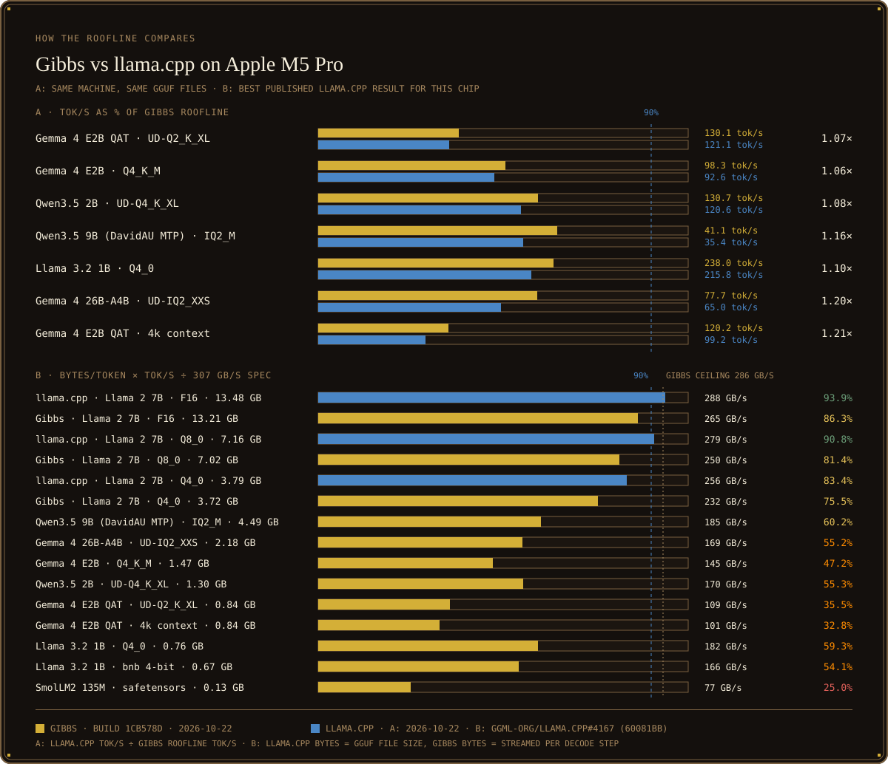
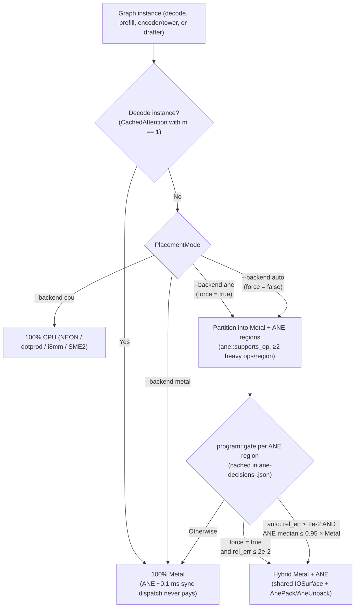

<picture>
  <source media="(prefers-reduced-motion: reduce)" srcset="assets/gibbs-hero-static.png">
  
</picture>

[Performance](#performance) · [Quickstart](#quickstart) · [Architecture](#architecture) · [Models](#models) · [Weight formats](#weight-formats) · [Usage](#usage) · [HTTP API](#http-api) · [DESIGN.md](DESIGN.md)

> *"The whole is simpler than the sum of its parts."*
> — **J. Willard Gibbs** (1839–1903), Professor of Mathematical Physics at Yale University

Gibbs is an LLM inference engine in Rust for Apple Silicon and multi-accelerator hosts. Models are described once in a shared graph IR and lowered to Apple Silicon Metal kernels by default, with graph regions moved to the Apple Neural Engine where measured faster (as well as CUDA, ROCm and Intel XPU through one runtime-compiled portable kernel layer, XLA through any PJRT plugin, and an explicit `--backend cpu` executor with ARM `sdot`/i8mm/SME2 kernels): every family runs on the GPU without silent CPU fallback, backed by paged KV prefix reuse, forward-only `qlabs.sh/noise` online speculative drafting, and automatic session compaction. Decode speed is measured against the machine's own memory-bandwidth roofline. Gibbs serves text, vision, audio, translation, classification, image and video models over OpenAI, OpenAI Responses, Anthropic and Ollama APIs, with a multi-turn terminal dashboard and a CLI.

## Performance


<!-- gibbs-bench:begin -->
| Model | Decode tok/s | Prefill tok/s | % of roofline | Roofline tok/s | GPU ms/token | Host ms/token | Dispatches/token | RSS GB |
| :--- | ---: | ---: | ---: | ---: | ---: | ---: | ---: | ---: |
| Gemma 4 E2B QAT · UD-Q2_K_XL | 130.1 | 2250 | 38.1% | 342 | 7.45 | 0.34 | 482 | 2.20 |
| Gemma 4 E2B · Q4_K_M | 98.3 | 2172 | 50.6% | 194 | 10.29 | 0.23 | 499 | 2.45 |
| Qwen3.5 2B · UD-Q4_K_XL | 130.7 | 2508 | 59.3% | 220 | 7.38 | 0.37 | 307 | 1.50 |
| Qwen3.5 9B (DavidAU MTP) · IQ2_M | 41.1 | 641 | 64.5% | 64 | 24.63 | 0.39 | 429 | 1.93 |
| Llama 3.2 1B · Q4_0 | 238.0 | 5075 | 63.6% | 374 | 3.88 | 0.38 | 163 | 0.30 |
| SmolLM2 135M · safetensors | 577.7 | 18005 | 26.8% | 2155 | 1.54 | 0.23 | 275 | 0.38 |
| Llama 3.2 1B · bnb 4-bit | 249.1 | 5187 | 58.0% | 429 | 3.73 | 0.32 | 149 | 4.70 |
| Gemma 4 26B-A4B · UD-IQ2_XXS | 77.7 | 469 | 59.2% | 131 | 12.87 | 0.03 | 552 | 2.82 |
| Gemma 4 E2B QAT · 4k context | 120.2 | 2123 | 35.2% | 342 | 8.08 | 0.34 | 482 | 2.51 |
| **Geomean** | | | **48.6%** | | | | | |

Apple M5 Pro, Metal, measured streaming ceiling 286.4 GB/s. Binary built from `1cb578d` (2026-10-22); `gibbs --bench bench/loop.json`: 128 decode tokens, median of 3 runs, `--reencode max-speed`; raw rows in [`autoresearch/bench-readme.jsonl`](autoresearch/bench-readme.jsonl). Roofline = ceiling ÷ bytes one decode step streams (`bytes_basis` in each row). 0 of 9 models reach the 90% roofline target; Gemma 4 E2B QAT decodes at 130.1 tok/s against its 150 tok/s target.

> paired ABBA cand mean across bench/loop.json rows 0..8 (64 decode tokens x 2 timed runs after warm-up, 512-token prefill on rows 0..7 and 4096-token prefill on row 8; max ABBA spread 0.038)
<!-- gibbs-bench:end -->

**Non-LM pipelines on Apple M5 Pro, Metal** (`bench/nonlm.json` + ModelScope video, build `1cb578d`):

| Model | Pipeline | Workload | Measured on Metal | Notes |
| :--- | :--- | :--- | ---: | :--- |
| `stabilityai/sd-turbo` | `diffusion` (UNet + CLIP + VAE) | 512×512, 4 steps (after 1 warm-up) | **0.339 s/step** | 3.88× faster than P0 baseline (`1.315 s/step`); same-machine `stable-diffusion.cpp` Metal is `0.282 s/step` |
| `sentence-transformers/all-MiniLM-L6-v2` | `encoder` (System 1 BERT) | 1024 items × 3 runs | **314.1 items/s** | 384-d L2-normalized embeddings |
| `google-t5/t5-small` | `encdec` (seq2seq EN→DE) | 32 decode tokens, FP32 bit-exact | **399.7 tok/s** | 1.46× faster than P0 FP32 baseline (`256.6 tok/s`) |
| `ali-vilab/text-to-video-ms-1.7b` | `video` (CLIP + UNet3D + VAE) | 16 frames, 256×256, 10 DDIM steps | **49.10 s** | 3.52× faster than P0 baseline (`172.96 s`) |

```bash
target/release/gibbs --bench bench/loop.json
target/release/gibbs --bench bench/nonlm.json
target/release/gibbs --bench-parity bench/loop.json
cargo run --release --example gibbs_art   # regenerates the hero, charts and these tables from autoresearch/bench-readme.jsonl and bench-reference.json
```

### How our roofline geomean compares to the best on the internet



<!-- gibbs-compare:begin -->
**Same machine, same GGUF / safetensors files.** llama.cpp: `llama-bench tg128, Metal`, Homebrew llama.cpp 0.6.0_1 (ggml 0.26.0), 2026-10-22 (plus `mlx_lm` on SmolLM2 safetensors), recorded in [`autoresearch/sprint3-probes.md`](autoresearch/sprint3-probes.md) (ib-P11). Gibbs: the table above (build `1cb578d`, 2026-10-22).

| Model | Ref engine | Gibbs decode tok/s | Ref decode tok/s | Gibbs ÷ Ref (decode) | Gibbs prefill tok/s | Ref prefill tok/s | Gibbs ÷ Ref (prefill) | Gibbs % of roofline | Ref % of Gibbs roofline |
| :--- | :--- | ---: | ---: | ---: | ---: | ---: | ---: | ---: | ---: |
| Gemma 4 E2B QAT · UD-Q2_K_XL | llama.cpp | 130.1 | 121.1 | 1.07× | 2250 | 3129 | 0.72× | 38.1% | 35.4% |
| Gemma 4 E2B · Q4_K_M | llama.cpp | 98.3 | 92.6 | 1.06× | 2172 | 2932 | 0.74× | 50.6% | 47.7% |
| Qwen3.5 2B · UD-Q4_K_XL | llama.cpp | 130.7 | 120.6 | 1.08× | 2508 | 3713 | 0.68× | 59.3% | 54.7% |
| Qwen3.5 9B (DavidAU MTP) · IQ2_M | llama.cpp | 41.1 | 35.4 | 1.16× | 641 | 856 | 0.75× | 64.5% | 55.5% |
| Llama 3.2 1B · Q4_0 | llama.cpp | 238.0 | 215.8 | 1.10× | 5075 | 6793 | 0.75× | 63.6% | 57.6% |
| SmolLM2 135M · safetensors | mlx_lm | 577.7 | 410.5 | 1.41× | 18005 | 8812 | 2.04× | 26.8% | 19.1% |
| Gemma 4 26B-A4B · UD-IQ2_XXS | llama.cpp | 77.7 | 65.0 | 1.20× | 469 | 1346 | 0.35× | 59.2% | 49.4% |
| Gemma 4 E2B QAT · 4k context | llama.cpp | 120.2 | 99.2 | 1.21× | 2123 | 2610 | 0.81× | 35.2% | 29.0% |

Ref % of Gibbs roofline = Ref decode tok/s ÷ Gibbs roofline tok/s (the bytes Gibbs streams per decode step), so both percentage columns share one scale. No same-machine reference number for: Llama 3.2 1B · bnb 4-bit.

**Best published result on this chip.** [ggml-org/llama.cpp#4167](https://github.com/ggml-org/llama.cpp/discussions/4167) lists an Apple M5 Pro, 16-core GPU (Apple spec 307 GB/s) running Llama 2 7B, `tg128`, llama.cpp `60081bb`:

| Engine · model | Bytes per token | tok/s | Effective GB/s | % of 307 GB/s spec | % of Gibbs's 286.4 GB/s ceiling |
| :--- | ---: | ---: | ---: | ---: | ---: |
| llama.cpp · Llama 2 7B F16 | 13.48 GB | 21.4 | 288.2 | 93.9% | 100.6% |
| Gibbs · Llama 2 7B F16 | 13.21 GB | 20.1 | 265.1 | 86.3% | 92.5% |
| llama.cpp · Llama 2 7B Q8_0 | 7.16 GB | 38.9 | 278.9 | 90.8% | 97.4% |
| Gibbs · Llama 2 7B Q8_0 | 7.02 GB | 35.6 | 249.9 | 81.4% | 87.3% |
| llama.cpp · Llama 2 7B Q4_0 | 3.79 GB | 67.6 | 256.2 | 83.4% | 89.4% |
| Gibbs · Llama 2 7B Q4_0 | 3.72 GB | 62.4 | 231.9 | 75.5% | 81.0% |
| Gibbs · Qwen3.5 9B (DavidAU MTP) · IQ2_M | 4.49 GB | 41.1 | 184.9 | 60.2% | 64.5% |
| Gibbs · Gemma 4 26B-A4B · UD-IQ2_XXS | 2.18 GB | 77.7 | 169.5 | 55.2% | 59.2% |
| Gibbs · Gemma 4 E2B · Q4_K_M | 1.47 GB | 98.3 | 144.9 | 47.2% | 50.6% |
| Gibbs · Qwen3.5 2B · UD-Q4_K_XL | 1.30 GB | 130.7 | 169.9 | 55.3% | 59.3% |
| Gibbs · Gemma 4 E2B QAT · UD-Q2_K_XL | 0.84 GB | 130.1 | 109.0 | 35.5% | 38.1% |
| Gibbs · Gemma 4 E2B QAT · 4k context | 0.84 GB | 120.2 | 100.7 | 32.8% | 35.2% |
| Gibbs · Llama 3.2 1B · Q4_0 | 0.76 GB | 238.0 | 182.1 | 59.3% | 63.6% |
| Gibbs · Llama 3.2 1B · bnb 4-bit | 0.67 GB | 249.1 | 166.2 | 54.1% | 58.0% |
| Gibbs · SmolLM2 135M · safetensors | 0.13 GB | 577.7 | 76.8 | 25.0% | 26.8% |

Effective GB/s = bytes per token × tok/s; llama.cpp's bytes are the GGUF file size, Gibbs's are the bytes one decode step streams. The file size includes the token-embedding table, of which a decode step reads one row, so the llama.cpp rates are slight upper bounds. On 3.8–13.5 GB per token, llama.cpp streams at 83–94% of the 307 GB/s spec; its F16 run reaches 288 GB/s, 100.6% of the 286.4 GB/s ceiling Gibbs measures. On the same Llama 2 7B variants (`bench/reference-7b.json`, `--reencode bit-exact`), Gibbs decodes at: F16 20.1 vs 21.4 tok/s (0.94×, 265.1 GB/s streamed = 92.5% of Gibbs's ceiling, prefill 401 tok/s); Q8_0 35.6 vs 38.9 tok/s (0.91×, 249.9 GB/s streamed = 87.3% of Gibbs's ceiling, prefill 971 tok/s); Q4_0 62.4 vs 67.6 tok/s (0.92×, 231.9 GB/s streamed = 81.0% of Gibbs's ceiling, prefill 977 tok/s). The default Gibbs suite streams 0.13–4.49 GB per token; its highest row is Qwen3.5 9B (DavidAU MTP) · IQ2_M at 60.2% of spec. The phase-by-phase optimization log is in [`autoresearch/roofline-loop.tsv`](autoresearch/roofline-loop.tsv).
<!-- gibbs-compare:end -->

## Quickstart

### Build
```bash
cargo build --release      # or: make release
# Produces ./target/release/gibbs

make tui                   # build, then open the dashboard
make tui ARGS="--model THUDM/glm-edge-1.5b-chat --port 8081"
```

### Run
```bash
# Defaults: --model HuggingFaceTB/SmolLM2-135M-Instruct, --port 8080, --backend auto (Metal on Apple Silicon), weights re-encoded per the Metal policy
./target/release/gibbs --model HuggingFaceTB/SmolLM2-135M-Instruct --port 8080 --tui

# GGUF checkpoint
./target/release/gibbs --model unsloth/SmolLM2-135M-Instruct-GGUF --port 8080

# CPU executor (explicit opt-in)
./target/release/gibbs --model unsloth/SmolLM2-135M-Instruct-GGUF --backend cpu --port 8080
```

### Connect a coding agent
Every API is a thin adapter over one generation path; any model name serves the loaded model and auth headers are ignored, so coding agents can use gibbs as a drop-in local backend while the TUI runs (`/connect` prints these with the real address):

| Client | Point it at | API |
| :--- | :--- | :--- |
| Claude Code | `ANTHROPIC_BASE_URL=http://127.0.0.1:8080 ANTHROPIC_AUTH_TOKEN=gibbs claude` | Anthropic `/v1/messages` (+ `/v1/messages/count_tokens`), SSE |
| Codex CLI | `~/.codex/config.toml`: `model_provider = "gibbs"`, `[model_providers.gibbs] base_url = "http://127.0.0.1:8080/v1"`, `wire_api = "responses"` | OpenAI `/v1/responses` (stateless; `previous_response_id` is a 400) |
| opencode / Continue / aider / OpenAI SDKs | base URL `http://127.0.0.1:8080/v1`, any API key | OpenAI `/v1/chat/completions`, `/v1/completions` |
| Ollama clients (`ollama run`, Open WebUI, …) | `OLLAMA_HOST=127.0.0.1:8080` | `/api/chat`, `/api/generate`, `/api/tags`, `/api/show`, `/api/ps`, `/api/version`, `GET`/`HEAD /` |

## Architecture


The design describes every model once in a shared graph IR (`src/graph`) and has each executor run that description; weights are bound by name, so the same graph can also be fingerprinted. Models compile to a `GraphProgram` that places every node on Metal by default, with measured-faster regions on the Apple Neural Engine (or on CUDA, ROCm, XLA/PJRT, Intel XPU, or the explicit `--backend cpu` executor). [PLAN.md](PLAN.md) has the phases and the measurements behind the design.

### Backends

| `--backend` | What runs there |
| :--- | :--- |
| `auto` (default) | On Apple Silicon: Metal, plus Apple Neural Engine regions only where measured faster (see `ane`). Elsewhere the first available of CUDA, ROCm, XLA and Intel XPU, in that order; `cpu` only on a host with none of them. |
| `metal` | The default Apple Silicon compute path. Every model family (see [GPU coverage](#gpu-coverage)) loads a Metal program. All graph ops lower on Metal (`tests/op_coverage.rs` has an empty known-unlowered list), including MPP `matmul2d`, `flash_attn_mm`, `conv_igemm`, 23-codec generated MSL GEMV, lock-free `Step::MegakernelMlp` with `Epi::UpSwiGlu`/`Epi::UpGeGlu`, paged `CachedAttention`, and exact parallel top-k sampling on the GPU (`sample_topk_part` / `sample_topk_final`) in `FedStream`. There is no silent CPU fallback: a model or op without a Metal lowering fails at load with a `gpu-only:` report that lists the avenues tried per node (Metal kernel, dtype adapt). A tripwire (`src/hardware/cpu_compute.rs`) panics if CPU compute runs while a Metal backend is active. |
| `ane` | Apple Neural Engine through the private `AppleNeuralEngine.framework` (`src/graph/ane/`: MIL lowering, in-memory compile, IOSurface evaluation). It is available only when its fp16 probe passes. Metal stays the primary device: a `GraphProgram` holds several segments (`CompiledSegment::Ane` beside Metal), and maximal runs of ANE-lowerable nodes with at least two matrix nodes become ANE regions, while state ops (`CachedAttention`, so all of decode) stay on Metal. Boundaries stay on the GPU through IOSurface-backed buffers (`Step::AnePack` / `Step::AneUnpack`, `src/graph/metal/ext/ane.metal`); only graph inputs and outputs are packed on the host. LLM prefill offers each full `prefill_rows` chunk (partial chunks stay on Metal); encoders, towers, diffusion and classifiers go through the same placement. **Gate:** each region runs 7 alternating timed rounds on Metal and on the ANE between real Metal segments and is kept when its relative RMS error is ≤ 2e-2 and its ANE median ≤ 0.95× Metal's; under `auto` the program with its kept regions must then also win whole. Decisions (including build failures) persist in `~/.cache/gibbs/host/ane-decisions-<os build>.json`, keyed by the graph, weight source and the lowering, boundary-kernel and gate sources. Regions stay on Metal once 100 ANE programs are compiled or ANE weights plus RSS would exceed 75% of memory. `--backend ane` skips the speed test and forces every lowerable region of every non-decode graph onto the ANE (the error test still applies; the load fails only when every region fails it); `--backend metal` never uses the ANE. **Drafters** are the one place state ops reach the ANE (`src/graph/ane/draft.rs`): `Plain` and `Mtp` drafters also compile their one-row decode step (`lower_drafter_step`: each `CachedAttention` becomes attention over a 1024-row K/V window held in the program's input surfaces with a validity-mask bias, the new K/V rows are extra outputs written into the window, and the leading `Embedding` runs on the host; wide one-row Linears split into ANE-sized convs and last-axis `Concat` lowers). The ANE step is checked against the Metal step at load (rel err ≤ 0.1, else the drafter stays on Metal and the log says why). Under `auto`, `KTuner::place` alternates Metal and ANE every 8 timed steps over the first 64 decode steps at the largest `k` and stores the faster under `drafter <label> <MIL hash>` in the same decisions file; later runs reuse it. On the ANE, `Plain` forks through `KvView::fork` and drafts while the target verifies. One sequence holds the ANE windows at a time (others draft on Metal); `Block` drafters stay on Metal. On an M5 Pro (2026-10-28) the ANE lost for both (Plain 2.9 vs 8.8 ms/token, Mtp 12.8 vs 16.7 ms/token, Metal first), so Metal is stored. |
| `cuda` | NVIDIA GPUs via runtime-loaded `libcuda` + `libnvrtc` (`DynLib`, no build-time CUDA SDK), running the portable kernels (`src/graph/portable/`, `kernels/*.gpk` compiled to PTX) through `PortableSession`; decode replays CUDA graphs (`src/graph/cuda.rs`). |
| `rocm` | AMD GPUs via runtime-loaded `libamdhip64` + `libhiprtc`, running the same portable kernels compiled for the device's `gfx` architecture; decode replays HIP graphs (`src/graph/rocm.rs`). |
| `xla` | Any PJRT plugin (`GIBBS_PJRT_PLUGIN`, `$TPU_LIBRARY_PATH`, or `libtpu.so` beside the `libtpu` Python package) through the PJRT C API (`src/graph/xla/pjrt.rs`). Each graph lowers to one StableHLO MLIR module of StableHLO ops only (`src/graph/xla/emit.rs`); weights upload once (BF16, F32 on `METAL`). Which ops the plugin compiles and runs is probed once per plugin and API version and cached in `~/.cache/gibbs/host/pjrt-*.json`; a graph using a rejected op fails to load with the plugin's error. |
| `intel-xpu` | Intel GPUs via runtime-loaded OpenCL 1.2 (`libOpenCL.so.1`, or `OpenCL.framework` on macOS), running the portable kernels as OpenCL C on the first platform whose name contains `Intel` (`GIBBS_XPU_ANY_OPENCL=1` accepts any platform; `src/graph/intel_xpu.rs`). |
| `cpu` | Explicit opt-in to the native CPU graph executor (`src/graph/cpu.rs`): packed linears run `src/model/qdot.rs` (activations quantized once per call to Q8_0/Q8_K; `sdot` kernels for q4_0, q8_0, iq4_nl, q4_k, q6_k, q2_k and tq2_0; `smmla` i8mm kernels for q4_0/q8_0/q4_k/q6_k above 8 activation rows; a block-decode path for every other format), dense GEMM uses SME2 `fmopa` 32×32 tiles (`src/model/sme2.rs`) when m, n ≥ 32 on SME2 hosts, and the `par::par_for` worker pool honors `nn::par_limit()`. |

Startup prints the detected host (CPU, core counts, memory, GPU, and CPU features such as SME2 and I8MM); nothing in it is assumed.

#### How Gibbs chooses between Metal, ANE, and hybrid execution



1. **Mode & eligibility (`src/graph/program.rs`):**
   - Single-token decode (`CachedAttention` with `m == 1`) **always runs 100% on Metal** (`is_decode`), because `_ANEInMemoryModel -evaluateWithQoS:` has ~0.1 ms synchronous dispatch overhead per evaluation.
   - When `ane::probe()` passes (`_ANEDeviceInfo +hasANE` plus a `[1, 64, 1, 64]` 1×1 conv probe in fp16/int8/int4), three non-decode workloads are eligible for ANE offload: encoders/towers/diffusion/classifiers (`compile_reshapable`), full-chunk LLM prefill (`rows == prefill_rows`, default 512), and `Plain` / `Mtp` model drafters (`src/graph/ane/draft.rs`).
2. **Static graph partitioning (`src/graph/placement.rs`, `src/graph/ane/mil.rs`):**
   - `place_graph` marks ops supported by `ane::supports_op` (`Linear` lowered as 1×1 conv, `MatMul`, norms, `Rope`, stateless `Attention`, `SwiGlu`/`GeGlu`, `Conv1d`/`Conv2d`, `Megakernel(Mlp)`, and elementwise/movement ops) as `Device::Ane`.
   - Stateful ops (`CachedAttention`, `CausalConv1d`, `DeltaRule`, `StateWrite`), `Embedding`, `Gather`, `Scatter`, `TopK`, `MoeLinear`, `Conv3d`, and `Concat` stay on `Device::Metal`.
   - Consecutive same-device nodes in topological order form segments. Any ANE segment with fewer than 2 heavy ops (`Linear` / `MatMul` / `Conv*` / `Megakernel`) is merged back into Metal so boundary conversion is never paid for trivial elementwise chains.
3. **Zero-copy hybrid execution (`SegmentExec` & `IOSurface`):**
   - Each tensor crossing a Metal↔ANE boundary lives in a page-aligned `IOSurface` in ANE's `[1, C, 1, S]` channel-major layout (64-byte channel stride), wrapped on the GPU via `newBufferWithBytesNoCopy`.
   - Metal encodes `Step::AnePack` (`[S, C]` → `[1, C, 1, S]`) at the end of a Metal segment and `Step::AneUnpack` (`[1, C, 1, S]` → `[S, C]`) at the start of the next Metal segment; no host `memcpy` occurs on interior boundaries.
4. **Measured gate (`program::gate` & `KTuner::place`):**
   - **Per-region gate (encoders, towers, LLM prefill):** guarded by `ANE_MAX_PROGRAMS = 100` and `current_rss + ane_weight_bytes <= 0.75 * hw.memsize`, keyed by an FNV-64 signature in `~/.cache/gibbs/host/ane-decisions-<os_build>.json`. On first sight, Gibbs compiles both the Metal segment and the ANE MIL program, runs 1 warm-up + 3 timed evaluations, and keeps the ANE region in `auto` mode only if `rel_err <= 2e-2` and `mixed_ms <= 0.95 * metal_ms` (including `AnePack`/`AneUnpack`).
   - **Whole-step drafter trial (`Plain` / `Mtp`):** `ane::lower_drafter_step` replaces `CachedAttention` with static 1024-row `IOSurface` KV rings so the entire drafter step runs on ANE and enables CPU-thread overlapped drafting (`Plain` on ANE proposes step $t+1$ while Metal verifies step $t$). Over the first 64 decode steps (alternating every 8 steps), `KTuner::place` times decode tok/s on Metal vs ANE, keeps the faster device, and persists the choice.

### Components

| Box | Status |
| :--- | :--- |
| Graph IR, CPU executor | Built (`src/graph/cpu.rs`, `src/model/par.rs`, `src/model/qdot.rs`, `src/model/sme2.rs`, `src/model/nn.rs`). Uses a spin-before-park `par::par_for` worker pool, thread-local `CpuArena` buffer reuse, direct quantized `sdot` / `smmla` linears and SME2 `fmopa` GEMM tiles. System 1 and `--backend cpu` run on it. |
| Graph builders & Canonical passes | Every model family is a JSON5 spec (`arch/families/*.json5`) built into a `graph::Graph` by `src/arch` and driven by the generic pipelines in `src/runtime/` (`causal_lm`, `encoder`, `encdec`, `diffusion`, `video`, `drafter`, `bag_classifier`; see [GPU coverage](#gpu-coverage) and [Supported models](#supported-models)). Supports `extends` / `use_lib` macro libraries, inline `Component::Ref { family, dir, strip, ignore, patch }`, `unary_act(name, fallback)` and `decoder_tail` macros, `reshape` `-1`/`0` inference, symmetric case-insensitive `AppliesTo`, graph-only canonical reductions every instance runs (`src/graph/passes/canonical.rs`: identity `Scale`/`Mul`/`Add`/`Reshape` removal, chained `Scale` and `Reshape` folding, commutative CSE, DCE, to a fixed point), and proportional RoPE active-plane pruning (`gemma4.json5` + zero-frequency identity fast-path). Prefill instances (`run_reshaped`) are canonicalized and fused too, with the 8 most recent instance shapes cached (`GraphProgram.reshaped_graphs`, `INSTANCE_SHAPES`). |
| Fingerprint pass | Built, on the IR. |
| Host profile | Static detection (the startup banner), plus measured Metal micro-benchmarks run once per GPU and OS build and cached in `~/.cache/gibbs/host/`: MPP `matmul2d` checked against the CPU, dispatch cost, and GEMM timings that pick the GEMM kernel per shape. `Runtime::shared()` warms up on a background thread in parallel with model loading and publishes cached codec efficiencies immediately. |
| Weight-format selection | **Metal:** the re-encode policy (`--reencode max-speed\|low-bit-native\|min-size\|bit-exact`, see [Weight formats](#weight-formats)) picks each streamed matrix's format from the weight header (`src/model/reencode.rs`, `weight_format.rs`) using measured `host_gbps`, `TensorRole` (`Router`, `LmHead`, `BoundaryAttn`, `AttnOrSsm`, `FfnDown`, `FfnGateUp`, `Other`), role-based RMSE sensitivity floors (tightened for a family's `runtime.sensitive_weights` globs), and `RETAINED_PENDING` tensor reuse across KL fallback rungs; non-`CausalLm` pipelines clamp to `bit-exact` unless `--quant` is explicitly set. Accepted re-encodes are persisted as zero-copy `.blocks` + `.index.json` + `<choice_key>.json` under `~/.cache/gibbs/reencoded/`. Variant ranking (`src/model/variant.rs`, policies `fastest`, `fastest-4bit`, `best-quality`) accounts for `WeightHeader::after` tied-tensor deduplication and MoE `k/n_experts` + MTP drafter streamed bytes per token in `VariantSummary::streamed_bytes_per_token`. `--quant` replaces the policy with one format for every weight matrix. |
| Metal & Multi-Hardware executors | `src/graph/metal.rs`, `src/graph/metal/ext/`, `src/graph/plan.rs`, `src/graph/ane/`, `src/graph/portable/` and `src/graph/{cuda,rocm,xla,intel_xpu}.rs`: the forward pass in command buffers, activations in one shared liveness arena (`SharedArenaPlan`), generated in-tile dequant MPP GEMM (`gemmgen_<fmt>_e<epi>`, `128×64` tiles on Metal 4 `matmul2d` without `dequant_scratch`), multi-row packed GEMV for 2–15 rows (`codegen::gemv_packed_mr`, every codec format: each weight block read once for up to 4 x rows, 3 for Q6_K/Q3_K; F32/F16/BF16 keep the per-row path, 1-row decode kernels are unchanged), grouped expert MPP GEMM (`moe_map_rows` + `gemmgen_id_<fmt>`), tiled flash attention on the matrix units (`flash_attn_mm`), split-key few-query attention for `nq < 8`, paged KV bound as per-name tables of page GPU addresses (`KvView::metal_desc`; kernels resolve one page base per 64-row page), implicit-GEMM 2D convolution (`conv_igemm`), a redundant-binding filter on every encoder (`Counted`), exact parallel top-k sampling in `FedStream` (one `SAMPLE_TOP_K = 50` shared with the scheduler, no repetition penalty), and pipelines cached in an `MTLBinaryArchive` under `~/.cache/gibbs/metal/`. 23 GGUF block formats decode on the GPU through generated MSL (`src/graph/codegen.rs` and `codec.rs`, bit-exact against the CPU dequantizer in `tests/codec_parity.rs`), plus hand GEMV kernels and a per-shape tuner (`src/graph/tune.rs`). CUDA, ROCm and Intel XPU share one portable kernel source (`src/graph/portable/kernels/*.gpk`, compiled at runtime as CUDA C++, HIP C++ or OpenCL C). |
| Fusion | Every fusion is an egglog rule; extraction picks the set. Graph level (`src/graph/egraph.rs`, cost-model extraction over the tune cache's GEMV rates, charging the dispatches each megakernel actually issues): `Step::MegakernelMlp` (RmsNorm → gate/up with `Epi::UpSwiGlu`/`Epi::UpGeGlu` → down → residual), and gate/up and QKV weight concatenation. Metal planner (`src/graph/metal/fuse.rs`, `ext/deltanet.rs`, rules over node and step facts that `plan` lowers 1:1): GEMV epilogues, 1-input `Op::RmsNorm` + `Binary(Mul, gamma)` into `Step::RmsNorm` / `RmsNormBatch`, RmsNorm residual/scale/RoPE, attention q/k RoPE, horizontal batching of up to four independent RmsNorm/Rope steps, MoE router/GLU/weighted-sum steps, and a decode-time gated delta-rule chain (conv step, SiLU, gates, state update, readout, gated RmsNorm) in one dispatch. Zero-copy views and small-GEMV pairing stay allocation-time post-passes (they need arena offsets and tuned variants). |
| Speculative decoding & Online Noise Drafter | Built-in MTP heads, attached `--draft` models (DFlash, DFlash2, DSpark, or small LMs), and zero-tap `OnlineNoiseDrafter` (`src/runtime/noise_draft.rs`: `SuffixLattice` $1..=4$-gram suffix continuation lattice + forward-only `qlabs.sh/noise` `NoiseBlockHead` over Walsh-Hadamard sketches of the target's own token embeddings, with refinement passes, node-perturbation hidden credit and ANVIL II moment updates, proposing sparse shortlist distributions that exact rejection sampling verifies, and drafting the next step on a forked state while the target verifies), coordinated by live `DraftKnobs` and the `KTuner` (`src/scheduler/spec.rs`, objective `speed` = tok/s or `tokens` = tokens per verify forward), which drafts only when measured or predicted to beat plain device-streamed decoding (see [Speculative decoding](#speculative-decoding)). |
| Paged KV, prefix reuse & Session Compaction | `KvPool` (`src/kv/mod.rs`): 64-token pages in 256-page slabs, one page class per attention window, read in place by the paged Metal and CPU attention kernels through per-sequence page tables (`KvView`), forks sharing pages by reference count, one process-wide byte budget (`--kv-mem`). `RadixPrefixCache` shares cached prompt prefixes token by token as page references (media prompts included; models with sliding windows or recurrent state resume only at a stored boundary), evicting unlocked leaves LRU before a pool grows, with cache-aware waiting-queue ordering in `ContinuousBatchScheduler`. Session compaction (`src/compact/`): Tier 1 thinking elision, Tier 2 artifact spill, Tier 3 cached model summary, and Tier 4 KV page eviction (sink page, recent pages, heaviest-key middle pages) when `--ctx` is below the model's context. |

### GPU coverage

<details><summary>52 model family specs (17 graph topologies), all on Metal</summary>

| family | status | unlowered ops |
|:---|:---|:---|
| GraphLm | GPU | — |
| Gemma4 | GPU | — |
| Hybrid | GPU | — |
| Gemma4Media | GPU | — |
| T5 | GPU | — |
| Seq2Seq | GPU | — |
| Idefics3Siglip | GPU | — |
| ClassifierBert | GPU | — |
| ClassifierModern | GPU | — |
| ClassifierDecoder | GPU | — |
| System1 | GPU | — |
| DiffusionUnet | GPU | — |
| DiffusionDit | GPU | — |
| Vae | GPU | — |
| VideoLtx | GPU | — |
| VideoModelScope | GPU | — |
| Audio | GPU | — |

Verified by `cargo test --release --test golden` (100 golden tests across all 52 family specs in `arch/families/*.json5`, including `enc::fasttext` bag-of-ngrams on Metal, matching the native CPU executor within relative error 1e-7..1e-5) and `cargo test --release --test cpu_free_matrix -- --nocapture`. Real-checkpoint verification on Metal is enforced by `scripts/golden_real.sh` across the 14 cached checkpoints and non-LM pipelines listed under [Verified on Metal](#verified-on-metal); every other family is verified on tiny synthetic fixtures on Metal.
</details>

### Compared with vLLM and SGLang

Gibbs is a different kind of engine from vLLM and SGLang. They target datacenter NVIDIA throughput, and Gibbs targets single-binary latency and roofline efficiency across Apple Silicon and multi-vendor accelerators.

|  | Gibbs | vLLM / SGLang |
| --- | --- | --- |
| Language and stack | Rust. One graph IR (`graph::Graph`, `GraphProgram`, built from JSON5 family specs) lowers to Metal kernels, runtime-compiled portable kernels on CUDA/ROCm/Intel XPU, StableHLO on any PJRT plugin, or an explicit `--backend cpu` executor. | Python on top of CUDA/Triton kernels. ROCm and others are secondary. |
| Primary hardware | Apple Silicon unified memory (Metal default, Neural Engine regions where measured faster), plus runtime-loaded CUDA, ROCm, XLA/PJRT, Intel XPU, and ARM `sdot`/i8mm/SME2 CPU. | NVIDIA GPUs, multi-GPU with tensor and pipeline parallelism. |
| Optimization goal | Single-stream decode against a measured memory-bandwidth roofline (`--bench`, `geomean_roofline_pct`), MLP megakernels, device-side `FedStream` sampling, and online `qlabs.sh/noise` drafting. | Aggregate throughput under many concurrent requests: continuous batching, paged KV cache (vLLM PagedAttention), prefix sharing (SGLang RadixAttention). |
| Quantization | Reads numerous formats directly (Q4_0, Q8_0, K-quants, IQ, TQ2_0 and others) through a codec layer, with role-aware (`TensorRole`) per-model re-encode policy. | Mostly GPTQ, AWQ, FP8 and similar server formats. GGUF support is limited. |
| Model breadth | Text LLMs, plus T5, classifiers, diffusion, video and audio families. | Mainly LLMs and VLMs. Diffusion and video are largely outside scope. |
| Scheduler | Continuous batching over a paged KV pool, radix prefix sharing over pages, cache-aware waiting-queue ordering, online `qlabs.sh/noise` speculative drafting, and automatic session compaction. | Core feature, and where most of their engineering goes. |
| UX | Built-in multi-turn TUI with 100%-height flexbox sidebar columns, roofline telemetry, `TURN` / `KV HIT` and `SPEC` ready/acceptance badges, live `F4` speed/policy options (`[FASTEST]` defaults and active `auto` resolution reasons), `↑`/`↓` prompt history retry/editing, trackpad/mouse-wheel scrolling, a CLI, and a local model picker. | Server-first, with an OpenAI-compatible API and no TUI. |

## Models

### Supported models

<details><summary>52 model family specs (`arch/families/*.json5`)</summary>

| Family | Pipeline | Matches |
|:---|:---|:---|
| `gemma3` | `causal_lm` | model_type: `gemma3_text`, `gemma3`; arch: `Gemma3ForCausalLM`, `Gemma3TextForSequenceClassification`, `Gemma3ForConditionalGeneration`; gguf: `gemma3` |
| `llama` | `causal_lm` | model_type: `llama`, `mistral`, `qwen2`, `smollm`, `smollm2`, `ernie4_5`, `phi3`; arch: `LlamaForCausalLM`, `MistralForCausalLM`, `Qwen2ForCausalLM`, `Ernie4_5ForCausalLM`, `Phi3ForCausalLM`, `LlamaForSequenceClassification`, `Qwen2ForSequenceClassification`; gguf: `llama`, `qwen2`, `ernie4_5`; fallback |
| `glm` | `causal_lm` | model_type: `glm`; arch: `GlmForCausalLM` |
| `granite` | `causal_lm` | model_type: `granite`, `granitemoehybrid`, `granitemoe`; arch: `GraniteForCausalLM`, `GraniteMoeHybridForCausalLM`, `GraniteMoeForCausalLM`; gguf: `granite`, `granitehybrid`, `granitemoe` |
| `bitnet` | `causal_lm` | model_type: `bitnet`; arch: `BitNetForCausalLM`, `BitnetForCausalLM`; gguf: `bitnet-b1.58`, `bitnet` |
| `gpt_neox` | `causal_lm` | model_type: `gpt_neox`; arch: `GPTNeoXForCausalLM`, `GPTNeoXForSequenceClassification` |
| `gpt2` | `causal_lm` | model_type: `gpt2`, `gpt_neo`; arch: `GPT2LMHeadModel`, `GPT2ForSequenceClassification`, `GPTNeoForCausalLM` |
| `opt` | `causal_lm` | model_type: `opt`; arch: `OPTForCausalLM`, `OPTForSequenceClassification` |
| `lfm2` | `causal_lm` | model_type: `lfm2`; arch: `Lfm2ForCausalLM`; gguf: `lfm2` |
| `krea2` | `diffusion` | gguf: `krea2`; diffusers: `Krea2Pipeline`, `Krea2Transformer2DModel` |
| `qwen_image` | `diffusion` | diffusers: `QwenImagePipeline`, `QwenImageTransformer2DModel` |
| `qwen_image21` | `diffusion` | gguf: `qwen_image`, `qwen_image21`; diffusers: `QwenImage21Pipeline`, `QwenImage21Transformer2DModel` |
| `qwen_vae` | `diffusion` | diffusers: `AutoencoderKLQwenImage` |
| `zimage` | `diffusion` | diffusers: `ZImagePipeline`, `ZImageTransformer2DModel` |
| `sd3` | `diffusion` | diffusers: `StableDiffusion3Pipeline` |
| `gemma2` | `encoder` | model_type: `gemma2`; arch: `Gemma2Model` |
| `sana` | `diffusion` | diffusers: `SanaPipeline` |
| `sd_vae` | `diffusion` | diffusers: `AutoencoderKL` |
| `dcae` | `diffusion` | diffusers: `AutoencoderDC` |
| `flux` | `diffusion` | diffusers: `FluxPipeline`, `FluxTransformer2DModel` |
| `chroma` | `diffusion` | diffusers: `ChromaPipeline`, `ChromaTransformer2DModel` |
| `flux2` | `diffusion` | diffusers: `Flux2KleinPipeline`, `Flux2Transformer2DModel` |
| `clip_text` | `encoder` | model_type: `clip_text_model`; arch: `CLIPTextModel`, `CLIPTextModelWithProjection` |
| `sd` | `diffusion` | diffusers: `StableDiffusionPipeline`, `LatentConsistencyModelPipeline`, `UNet2DConditionModel` |
| `sdxl` | `diffusion` | diffusers: `StableDiffusionXLPipeline` |
| `sd1_file` | `diffusion` | single-file |
| `sd2_file` | `diffusion` | single-file |
| `sdxl_file` | `diffusion` | single-file |
| `sd2_gguf` | `diffusion` | single-file |
| `idefics3` | `causal_lm` | model_type: `idefics3`, `smolvlm`; arch: `Idefics3ForConditionalGeneration` |
| `dflash` | `drafter` | arch: `DFlashDraftModel`, `DFlash2DraftModel`, `DSparkDraftModel`, `Qwen3DSparkModel`; gguf: `dflash` |
| `qwen3_5` | `causal_lm` | model_type: `qwen3_5`, `qwen3_5_text`, `qwen3_5_moe`, `qwen3_5_moe_text`; arch: `Qwen3_5ForSequenceClassification`, `Qwen3_5TextForSequenceClassification`; gguf: `qwen35`, `qwen35moe` |
| `qwen3` | `causal_lm` | model_type: `qwen3`, `qwen3_moe`; arch: `Qwen3ForCausalLM`, `Qwen3MoeForCausalLM`, `Qwen3ForSequenceClassification`; gguf: `qwen3`, `qwen3moe` |
| `hunyuan` | `causal_lm` | model_type: `hunyuan_v1_dense`; arch: `HunYuanDenseV1ForCausalLM`; gguf: `hunyuan-dense` |
| `qwen3_vl` | `causal_lm` | model_type: `qwen3_vl`; arch: `Qwen3VLForConditionalGeneration`; gguf: `qwen3vl` |
| `qwen4_exp` | `causal_lm` | model_type: `qwen4_exp`, `qwen4_exp_text`; arch: `Qwen4ExpForCausalLM`; gguf: `qwen4exp` |
| `gemma4` | `causal_lm` | model_type: `gemma4`, `gemma4_text`; arch: `Gemma4ForConditionalGeneration`, `Gemma4ForCausalLM`, `Gemma4ForSequenceClassification`; gguf: `gemma4` |
| `gemma4_unified` | `causal_lm` | model_type: `gemma4_unified`; arch: `Gemma4UnifiedForConditionalGeneration` |
| `t5` | `encdec` | model_type: `t5`, `mt5`, `umt5`; arch: `T5ForConditionalGeneration`, `MT5ForConditionalGeneration`, `UMT5ForConditionalGeneration`, `T5EncoderModel`, `UMT5EncoderModel`; gguf: `t5`, `t5encoder` |
| `bart` | `encdec` | model_type: `bart`, `mbart`; arch: `BartForConditionalGeneration`, `MBartForConditionalGeneration` |
| `marian` | `encdec` | model_type: `marian`; arch: `MarianMTModel` |
| `m2m100` | `encdec` | model_type: `m2m_100`; arch: `M2M100ForConditionalGeneration` |
| `fsmt` | `encdec` | model_type: `fsmt`; arch: `FSMTForConditionalGeneration` |
| `electra` | `encoder` | model_type: `electra`; arch: `ElectraForSequenceClassification`, `ElectraModel` |
| `albert` | `encoder` | model_type: `albert`; arch: `AlbertForSequenceClassification`, `AlbertModel` |
| `bert` | `encoder` | model_type: `bert`; arch: `BertForSequenceClassification`, `RobertaForSequenceClassification`, `XLMRobertaForSequenceClassification`, `CamembertForSequenceClassification`, `DistilBertForSequenceClassification`, `BertModel` |
| `modernbert` | `encoder` | model_type: `modernbert`; arch: `ModernBertForSequenceClassification`, `ModernBertModel` |
| `bert_gguf` | `encoder` | gguf: `bert` |
| `deberta` | `encoder` | arch: `DebertaForSequenceClassification`, `DebertaV2ForSequenceClassification`, `DebertaModel`, `DebertaV2Model` |
| `ltx` | `video` | diffusers: `LTXPipeline`, `LTXImageToVideoPipeline`, `LTXVideoTransformer3DModel` |
| `ltx_vae` | `video` | diffusers: `AutoencoderKLLTXVideo` |
| `modelscope_t2v` | `video` | diffusers: `TextToVideoSDPipeline`, `UNet3DConditionModel` |

Generated from `arch/families/*.json5` (`Registry::supported_models_markdown`).

</details>

### Model specs and overrides

Every model family is defined as a JSON5 spec in `arch/families/<family>.json5` (with shared macro libraries in `arch/lib/*.json5`, tensor-name rules in `arch/names/*.json5`, and embedded overrides in `arch/overrides/quant_sensitivity.json5` and `arch/overrides/reasoning_thinking.json5`). A spec declares:
- `family`, optional `extends` (parent family merged first via RFC 7386 merge patch; `key+` appends arrays), `match` (`hf_model_type`, `hf_architectures`, `gguf_arch`, `diffusers_class`, `file_ext`, `fallback`), and `pipeline` (`causal_lm`, `encoder`, `encdec`, `diffusion`, `video`, `drafter`, `bag_classifier`, `unsupported`).
- `config` expressions (`cfg.*`, `gguf.*`, `json.*`, `shape()`, `has()`, `count()`), load-time `checks`, `names` rename rules, `transforms`, generated `constants`, `ignore` globs, `macros` (including `unary_act(name, fallback)` and `decoder_tail`), `components` networks (`vars`, `inputs`, `body` with `{use_lib: "<block>", args: {...}}` library expansion and `reshape` `-1`/`0` dimension inference, `outputs`, or inline `Component::Ref` sub-model references `{family, dir, strip, ignore, patch}`), and pipeline `runtime` metadata.

User files under `~/.cache/gibbs/arch/families/*.json5` replace an embedded family of the same name or add a new family; user override files under `~/.cache/gibbs/arch/overrides/*.json5` (`{applies_to: {hub_id, family, model_type, hf_architectures, gguf_arch, diffusers_class, file_name}, patch: {...}}`, where every field accepts a string or list of strings and matches case-insensitively with `*` globs) patch matching checkpoints after embedded overrides. Malformed user files log a warning and are skipped without aborting startup. `--arch <family>` forces a specific family spec, and `--arch-dump` prints the merged spec, resolved config variables, canonical tensor renames, and unconsumed tensors as JSON and exits.

### Verified on Metal

Verification status depends on where a model ran. **On Metal with a real checkpoint** (checked by `scripts/golden_real.sh check target/release/gibbs` and `bench/nonlm.json`):

| Model | Task | What was checked |
| :--- | :--- | :--- |
| `smollm2-st` (`HuggingFaceTB/SmolLM2-135M-Instruct`), `llama32-q4_0` (`unsloth/Llama-3.2-1B-Instruct-GGUF` Q4_0), `llama32-bnb` (`unsloth/Llama-3.2-1B-Instruct-bnb-4bit`) | Text generation (`llama`) | Greedy tokens match `tests/golden_real.expected.tsv` on Metal; benchmarked in [Performance](#performance). |
| `qwen35-2b` (`unsloth/Qwen3.5-2B-GGUF` UD-Q4_K_XL), `qwen35-9b-iq2m` (DavidAU MTP IQ2_M), `kev-08b` (`Qwen/Qwen3.5-0.8B`), `tev-mlx4` (MLX 4-bit Qwen3.5) | Text generation (`qwen3_5`) | Greedy tokens match `tests/golden_real.expected.tsv` on Metal; `qwen35-2b` and `qwen35-9b-iq2m` benchmarked above. |
| `gemma4-e2b-q4_0`, `gemma4-e2b-q4km`, `gemma4-e2b-qat`, `gemma4-e4b-qat`, `gemma4-12b` (`gemma4_unified`), `gemma4-26b-a4b` (UD-IQ2_XXS MoE) | Text generation (`gemma4` / `gemma4_unified`) | Greedy tokens match `tests/golden_real.expected.tsv` on Metal; logits match llama.cpp within 0.04; vision + audio (`ggml-org/gemma-4-E2B-it-GGUF` + mmproj) answers "Red" and "Banana". |
| `t5-small` (`google-t5/t5-small`) | Translation (`t5`) | `translate English to German: The house is wonderful.` → `Das Haus ist wunderbar.` at **399.7 tok/s** on Metal (FP32 bit-exact). |
| `stabilityai/sd-turbo` | Text-to-image (`sd` + `clip_text` + `sd_vae`) | 512×512 4-step generation at **0.339 s/step** on Metal (`conv_igemm` + `flash_attn_mm`). |
| `sentence-transformers/all-MiniLM-L6-v2` | Embeddings (`bert`) | 384-d L2-normalized embeddings at **314.1 items/s** on Metal. |
| `ali-vilab/text-to-video-ms-1.7b` | Text-to-video (`modelscope_t2v`) | 16 frames, 256×256, 10 DDIM steps in **49.10 s** on Metal. |
| Qwen-Image 2.1 Q4_0 DiT | One transformer forward (`qwen_image21`) | Relative error 1.5e-5 against the CPU forward. |
| `bench/loop.json` models | Text generation | `--bench-parity`: Metal program vs the CPU graph executor, min cosine 1.00000 over 8–16 decode steps; decode and prefill speed in [Performance](#performance). |

Everything else on Metal (other classifiers, Marian/BART/NLLB, SigLIP/Idefics3, Qwen3-VL vision, MTP/DFlash drafters, `.ninfer`, FLUX/SD3/Krea/Z-Image/Sana DiTs, LTX DiT) is verified on tiny synthetic fixtures via `cargo test --release --test golden`.

### Verified on the CPU executor

**Verified on the CPU executor (`--backend cpu`, or before the GPU-only default).** The table below records what ran on real weights, mostly on the native CPU forward passes; its rows say "CPU" where that is the case. Metal was not re-run on these checkpoints. The older tok/s and s/step figures in it are from earlier releases on a shared host and are not comparable to the [bench above](#performance).

<details><summary>Real-weight checks on the CPU executor (33 rows)</summary>

| Model | Task | Notes |
| :--- | :--- | :--- |
| `HuggingFaceTB/SmolLM2-135M-Instruct` (safetensors) and `unsloth/SmolLM2-135M-Instruct-GGUF` (Q4_K_M) | Text generation | Greedy output matches llama.cpp token-for-token on Q4_K_M. |
| `THUDM/glm-edge-1.5b-chat` | Text generation | |
| `Qwen/Qwen2.5-0.5B-Instruct` | Text generation | Downloaded, measured, and hot-swapped from the TUI model picker; answers coherently (e.g. "The capital of France is Paris."). Not compared token-for-token against a reference implementation. |
| `Qwen/Qwen2.5-3B-Instruct` | Text generation, sharded safetensors (2 shards, bf16) | Loads through `model.safetensors.index.json`; "The capital of France is Paris." |
| `HuggingFaceTB/SmolLM2-135M-Instruct` `onnx/*.onnx`, `onnx-community/Qwen2.5-Coder-0.5B-Instruct` | Text generation, ONNX | f32 exports (Qwen's with 2 GB external data) match the safetensors originals tensor for tensor (max abs diff 0) and give the same greedy answer; fp16 is within fp16 rounding; int8/uint8/quantized cosine ≥ 0.993, q4/q4f16/bnb4 ≥ 0.994 against the original. `onnx-community/SmolLM2-135M-Instruct-ONNX` was downloaded and hot-swapped from the TUI picker. |
| RedHatAI `Qwen2.5-0.5B-Instruct-quantized.w8a8`, `-FP8-dynamic`, `Qwen2.5-0.5B-quantized.w4a16`, `.w8a16`; `xihc-ucb/Qwen2.5-0.5B-Instruct-vLLM-FP8-Block`; `nm-testing/TinyLlama-1.1B-Chat-v1.0-NVFP4` | Text generation, compressed-tensors | Dequantized tensors against the unquantized originals: min cosine 0.9998 (int8), 0.9997 (FP8 channel and 128×128 block), 0.992 (int4 g64 with g_idx), 0.995 (NVFP4). Instruct models answer "The capital of France is Paris." |
| `CedricHwang/qwen2.5-0.5b-modelopt-fp8-pc-pt`, `Azzam15/qwen2.5-0.5b-nvfp4` | Text generation, NVIDIA modelopt FP8 / NVFP4 | Min cosine 0.9997 / 0.9955 against Qwen2.5-0.5B-Instruct; both answer "The capital of France is Paris." |
| `bartowski/SmolLM2-135M-Instruct-GGUF`, `mradermacher/SmolLM2-135M-Instruct-i1-GGUF`, `Mungert/TriLM_1.1B_Unpacked-GGUF`, `noctrex/SmallThinker-4B-A0.6B-Instruct-MXFP4_MOE-GGUF` | GGUF quant types | Relative RMS error of every tensor against the float GGUF (`tests/gguf_quant_accuracy.rs`): Q8_0 0.006, Q6_K 0.018, Q5_K 0.037, Q4_K 0.076, IQ4_XS 0.080, IQ4_NL 0.058–0.078, MXFP4 0.117 (vs Q8_0), Q3_K 0.152, IQ3_S 0.147, IQ3_XXS 0.194, Q2_K 0.279, IQ2_S 0.264, IQ2_XS 0.313, IQ2_XXS 0.360, IQ1_M 0.477, IQ1_S 0.511, TQ1_0/TQ2_0 0.004 (ternary weights). SmolLM2 Q2_K, Q3_K_M, IQ4_XS, IQ2_M and IQ1_M answer "The capital of France is Paris" (IQ1_M repetitively). |
| `microsoft/bitnet-b1.58-2B-4T` (packed 2-bit), `-bf16` (master weights, ternarized at load), `-gguf` (`ggml-model-i2_s.gguf`, bitnet.cpp I2_S); `1bitLLM/bitnet_b1_58-large` | Text generation, BitNet b1.58 | Per-token int8 activation quant before every projection, `attn_sub_norm`/`ffn_sub_norm`, relu² (2B-4T) or SiLU (1bitLLM) MLP, as in the reference BitLinear. The three 2B-4T variants answer "The capital of France is Paris." at temperature 0. I2_S and packed codes match on all 210 tensors; bf16 masters ternarize to the packed codes except 1.53% that sit within one bf16 step of the rounding threshold. 1bitLLM-large continues "The capital of France is" with " Paris. It is the largest city…". CPU only. |
| `nickypro/tinyllama-110M` (`pytorch_model.bin` only); `nickypro/tinyllama-15M`, `distilbert/distilgpt2`, `hf-internal-testing/tiny-random-bert-sharded`, `mlx-community/whisper-tiny` | PyTorch / Flax / NumPy weights | tinyllama-110M serves `/v1/completions` coherently from its pickle. `.bin`, sharded `.bin`, `flax_model.msgpack`, and `weights.npz` load to tensors bit-identical to the same model's safetensors (or, for whisper-tiny's npz, OpenAI's `tiny.pt`). |
| `Qwen/Qwen3.5-0.8B`, `Qwen/Qwen3.5-2B`, `Qwen/Qwen3-VL-2B-Instruct` | Image-text-to-text (native, CPU, bf16) | Hybrid Gated DeltaNet / gated-attention decoder (Qwen3.5) or dense Qwen3 with deepstack (Qwen3-VL), ViT with interleaved M-RoPE. Answer "Paris" and describe photos of a cat, a dog, the Eiffel Tower and a banana correctly at temperature 0. 0.8B decodes at ~5 tok/s on a heavily loaded host (load average 76–200). |
| `tencent/HY-MT1.5-1.8B-GGUF` (Q4_K_M, llama.cpp `hunyuan-dense`); `unsloth/Qwen3.5-0.8B-GGUF` (BF16, Q8_0) and `unsloth/Qwen3.5-4B-GGUF` (Q3_K_S) (llama.cpp `qwen35`) | Translation and text generation from llama.cpp GGUFs (native, CPU, dequantized to bf16) | llama.cpp's conversion transforms are undone at load (`1 + w` norms, tiled value heads). HY-MT's GGUF tokenizer encodes 13 strings (CJK, kana, digit runs, emoji, whitespace runs) to the same ids as its tokenizer.json, and the model card's en→zh, zh→en and en→de prompts translate correctly at temperature 0. Qwen3.5-0.8B: all 320 tensors against the bf16 safetensors, min cosine 0.9999974 (BF16) / 0.9999762 (Q8_0); greedy chats are token-identical on BF16, and Q8_0 matches on 2 of 3, splitting on the third after 4 tokens. |
| `tvall43/Qwen3.5-14B-A3B-Claude-4.6-Opus-Reasoning-Distilled-reap-gguf` (MXFP4_MOE, llama.cpp `qwen35moe`: 40 layers, 93 experts, top-8); `Lynxpda/micro-qwen4exp` (Q4_K_M, F16, `qwen4exp`); `malaiwah/qwen4-exp-tiny-random-bf16` (`qwen4_exp` safetensors) | Qwen3.5-MoE and Qwen4-Exp text generation (native, CPU) | Expert banks stay packed in the mmapped file (GGUF block codecs decode one weight row per routed token group; bf16 safetensors experts are borrowed from the mapping); routing is softmax top-k with the sigmoid-gated shared expert. Qwen4-Exp adds hyper-connection streams, QSA block-sparse attention and the hashed n-gram PLE layer; no MTP head, vision tower or rewind. Qwen3.5-MoE GGUF: logits cosine 0.9984 and the same greedy token as llama.cpp on a 2-token prompt; answers "Paris". |
| `HuggingFaceTB/SmolVLM-256M-Instruct`, `SmolVLM-500M-Instruct`, `SmolVLM2-256M-Video-Instruct` (images) | Image-text-to-text (`idefics3` spec: SigLIP + pixel-shuffle connector + llama text model) | Preprocessing follows `Idefics3ImageProcessor` (longest edge 2048, 512-px tiles plus a global view, 64 tokens per tile). Describes the same four photos correctly from PNG, baseline JPEG and progressive JPEG; a drawn red disc gives "Red."; text prompts answer "Paris". An image is up to ~1100 prompt tokens, prefilled one token at a time. |
| `google/gemma-4-E2B-it`, `google/gemma-4-E4B-it` | Any-to-any: text + image + speech (WAV, ≤30 s) → text (native, CPU, bf16 memory-mapped) | Per-layer embeddings, sliding/full attention with KV sharing, softcapped logits, vision tower and conformer audio encoder as in transformers. Correct factual answers, photo descriptions, and word-for-word transcripts of `say`-generated speech at temperature 0; a >1100-token prompt prefilled in chunks matches one-shot prefill. RSS ~5 GB (E2B) / ~10 GB (E4B). |
| `google/gemma-4-12B-it` (`gemma4_unified`) | Text + image + WAV audio → text (native, CPU, bf16 memory-mapped) | Encoder-free image and audio embedders; image tokens attend bidirectionally on sliding layers, and chunked prefill never splits an image. At temperature 0: "Paris", "Cat" for a cat photo, correct descriptions of the Eiffel Tower, a banana and a dog, and word-for-word transcripts of 16 kHz and 22 kHz WAVs (tests and HTTP). Peak memory 25.3 GB; ~5 tok/s decode, 14–17 tok/s prefill. `/v1/messages/count_tokens` counts images and audio without running the encoders. |
| `ggml-org/gemma-4-E2B-it-GGUF` (`gemma-4-E2B-it-Q4_0.gguf` + `mmproj-gemma-4-E2B-it-Q8_0.gguf`, llama.cpp `gemma4`) | Any-to-any from a llama.cpp GGUF: text + image + speech → text (native, CPU, dequantized to bf16) | The decoder's tensors are renamed to their transformers names and the `gemma4.*` metadata becomes the config (sliding pattern, per-type head dims and KV heads, shared-KV layers, per-layer embeddings, softcap, the `rope_freqs` 1/1e30 mask → partial rotary); the per-layer embedding table stays quantized in the mapped file and its rows are decoded per token. The `mmproj` (`gemma4v` / `gemma4a`) is fetched with the weights and renamed to the vision and audio towers (conv kernel re-laid-out, softplus'ed `per_dim_scale` inverted). The GGUF tokenizer encodes audio bytes directly. Cosine vs transformers safetensors: text logits 0.99979, image logits 0.99986, audio logits 0.99979; answers "Paris", names the photo contents, transcribes WAV audio. |
| `Qwen/Qwen3-0.6B`, `Qwen/Qwen3-1.7B`, `Qwen/Qwen3-0.6B-GGUF` (Q8_0), `unsloth/Qwen3-0.6B-GGUF` (BF16), `tencent/Hunyuan-0.5B-Instruct`, `tencent/Hunyuan-MT-7B` | Text generation, translation (native, CPU, bf16) | Dense Qwen3 and HunYuan dense v1 on the native bf16 decoder. Qwen3-0.6B logits within 9.3e-5 of a scalar f32 reference written from `modeling_qwen3.py`; the BF16 GGUF decodes token-for-token like the safetensors repo. "Paris", "Jupiter", "391" at temperature 0 with thinking on and off (1.7B). Hunyuan-MT-7B translates EN→ZH, EN→FR and ZH→EN correctly at 14.3 GB peak RSS. |
| `google-t5/t5-small`, `google/t5-v1_1-small`, `google/flan-t5-base`, `google/umt5-small`, `csebuetnlp/mT5_multilingual_XLSum`, `google/madlad400-3b-mt` (candle q4k GGUF) | T5 / mT5 / UMT5 (native, CPU) | Scores match transformers' integration tests (t5-small −19.0846 vs −19.0845, t5-v1_1-small −59.0293 vs −59.0293); umt5-small fills spans exactly as transformers. t5-small: "Das Haus ist wunderbar."; MADLAD (`<2de>` prefix) translates to German, French and Japanese at ~13.8 GB peak. |
| `facebook/wmt19-en-de` (FSMT), `facebook/m2m100_418M`, `Helsinki-NLP/opus-mt-tc-big-en-pt`, `facebook/mbart-large-50-many-to-many-mmt` (ar→en), `sshleifer/distilbart-cnn-12-6`; `Helsinki-NLP/opus-mt-en-de`, `facebook/nllb-200-distilled-600M` | Translation, summarization (encoder-decoder, CPU) | Outputs equal the model-card / transformers-docs examples exactly. Known mismatches: mbart-50 hi→fr ("en Syria" vs the card's "dans la") and bart-large-cnn's summary. NLLB streams token by token. |
| `puettmann/LlaMaestra-3.2-1B-Translation`, `puettmann/SmolMaestra-1.7b-Translation`, `BSC-LT/salamandraTA-2b-instruct` | Translation (decoder-only) | Picker shows them loadable; correct translations over HTTP at temperature 0. |
| `distilbert/distilbert-base-uncased-finetuned-sst-2-english`, `cardiffnlp/twitter-roberta-base-sentiment-latest`, `SamLowe/roberta-base-go_emotions`, `papluca/xlm-roberta-base-language-detection`, `protectai/deberta-v3-base-prompt-injection-v2`, `cross-encoder/ms-marco-MiniLM-L-6-v2`, `BAAI/bge-reranker-base`, `trl-lib/Qwen2-0.5B-Reward`, `Skywork/Skywork-Reward-V2-Llama-3.2-1B` | Text classification, reranking, reward scoring | BERT/RoBERTa/XLM-R/DistilBERT run on the System 1 BERT graph (CPU or Metal); DeBERTa-v2/v3 and Llama/Qwen2 `ForSequenceClassification` on CPU. Match model-card values: twitter-roberta 0.7236/0.2287/0.0477, ms-marco 8.607/−4.320; go_emotions scores as multi-label; rerankers and reward models order relevant/correct answers first. |
| `cirimus/modernbert-base-go-emotions`, `cmarkea/distilcamembert-base-sentiment`, `daekeun-ml/koelectra-small-v3-nsmc`, `KoalaAI/Text-Moderation`, `tals/albert-xlarge-vitaminc-mnli`, `nie3e/sentiment-polish-gpt2-small`, `hfmlsoc/ncii-guard-v02`, `facebook/fasttext-language-identification`, `olaverse/lid-lite-608`, `gpustack/bge-reranker-v2-m3-GGUF`, `alirezaaminzadeh/agentshield-policy-decision-model`, `vllm-sr/mmbert-jailbreak-detector-lora`, `velddev/nest-sparrow-checkpoint`, `Skywork/Skywork-Reward-V2-Qwen3-0.6B`, `anespo28/openjev-fincalc-4b` | Text classification: ModernBERT, CamemBERT, ELECTRA, DeBERTa v1, ALBERT, GPT-2, OPT, Gemma 3 text, Qwen3, Qwen3.5, fastText, GGUF (`bert`), SetFit, PEFT LoRA | Card values reproduced: go-emotions 0.9756/0.6978/0.6083, distilcamembert 0.9855 positive, koelectra 0.9639 negative, moderation scores matched, Polish GPT-2 0.9997, NCII Guard 0.9996 safe, fastText/lid-lite language IDs correct, BGE reranker orders correctly, AgentShield safe, mmbert LoRA jailbreak flag correct, nest-sparrow scores match card, Skywork-Qwen3 reward orders correctly. |
| `gpustack/stable-diffusion-v2-1-turbo-GGUF` | Text-to-image and image-to-image, 512×512 | By default the smallest quant (Q4_0) is used, and it produces striped images. Set `GIBBS_QUANT=FP16` for clean 1-step images. |
| `stabilityai/sd-turbo`, `stable-diffusion-v1-5/stable-diffusion-v1-5`, `stabilityai/sdxl-turbo`, `stabilityai/stable-diffusion-xl-base-1.0`, `SimianLuo/LCM_Dreamshaper_v7`; LoRAs `SedatAl/pixel-art-LoRa` (SD1.5), `nerijs/pixel-art-xl` (SDXL); single-file `HyperX-Sentience/Juggernaut-Reborn` | Text-to-image, image-to-image (diffusers, CPU) | On-prompt images, checked by eye. s/step (denoising) and peak RSS: sd-turbo 1 step 512 ~16 s/image, 5.2 GB; SD1.5 20 steps CFG 7.5 5.4–6.2, 4.9 GB; sdxl-turbo 1 step 4.2, 12.3 GB; SDXL base 768² CFG 5 13.0, 12.4 GB; LCM 4 steps 768 10.2, 4.1 GB; SD1.5 LoRA ~8.3, 4.8 GB; SDXL LoRA 11.5, 13.0 GB; Juggernaut 6.9, 4.9 GB. LoRAs visibly change style against the same seed without them. |
| `Efficient-Large-Model/Sana_600M_512px_diffusers`, `adamo1139/stable-diffusion-3.5-medium-ungated` | Text-to-image (DiT, CPU) | Verified before the final rebase: Sana 512px 20 steps 3.94 s/step, 7.46 GB (CLI, HTTP and TUI); SD3.5-medium 512px 28 steps 10.95 s/step, 15.67 GB. Host was shared, so s/step is an upper bound. |
| `city96/FLUX.1-schnell-gguf` (`flux1-schnell-Q4_0.gguf`) with FLUX.1-schnell's CLIP-L, T5-XXL and VAE | Text-to-image (FLUX, CPU) | On-prompt fox at 512², 4 steps: 52–68 s/step on a shared host, peak RSS 17.06 GB. Pre-rebase code, through a test driver rather than the hub path. |
| `turboderp/Llama-3.2-1B-Instruct-exl3@4.0bpw` / `@2.5bpw`, `blockblockblock/Qwen2.5-0.5B-Instruct-exl3-4.0bpw` / `-3.0bpw`, `turboderp/Qwen3-0.6B-exl3@4.0bpw`, `Honkware/Qwen3.5-0.8B-exl3-4.0bpw` | Text generation, EXL3 | Tiles bit-exact against the reference kernel (3INST, MCG, MUL1, half-integer K). Cosine vs the unquantized original: 4-bit 0.9962–0.9974, head 0.9997+, 3-bit 0.9856–0.9897, 2-bit 0.9443–0.9601. All answer "Paris"; the Qwen3.5 model also names a cat in a photo. |
| `amd-quark/Qwen3-1.7B-MXFP4`, `matmelis/Llama_3.2_1B_w_mxfp4_a_mxfp4_gptq`, `matmelis/Llama_3.2_1B_w_uint4_gptq`, `aigdat/Llama-3.2-1B-Instruct-awq-uint4-float16`, `amd/Qwen2.5-1.5B-Instruct-ptpc-Quark-ts`, `amd/Llama-3.2-1B-Instruct-FP8-KV` | Text generation, AMD Quark / `fp8` | All answer "Paris" at temperature 0. Worst cosine vs original: fp8 0.9996, int8 0.992, uint4/int4 GPTQ 0.982–0.987, MXFP4 0.982, MXFP6 0.9986–0.9995, int3 0.944, int2 0.776 (GPTQ optimizes output error, not weight error). |
| `xv0y5ncu/SmolLM2-135M-Instruct-GLQ-4bpw`, `xv0y5ncu/SmolLM2-360M-Instruct-GLQ-trellis-3inst-4bpw` | Text generation, GLQ | Worst cosine 0.99386 / 0.99545 vs the bf16 originals, through the family spec; both answer "Paris". |
| `Qwen/Qwen3.5-0.8B`, `Qwen/Qwen3.5-2B` with their MTP head; attached drafters `rasyosef/Qwen3.5-2B-DSpark`, `rasyosef/Qwen3.5-2B-DFlash2`, `taobao-mnn/Qwen3.5-2B-Dflash`, `Qwen/Qwen3.5-0.8B` (plain draft model), `rasyosef/Llama-3.2-1B-Instruct-DSpark` | Speculative decoding | Greedy output token-identical to plain decoding for every pair (measured with the previous host-Rust drafters; the spec drafters are checked on tiny fixtures only). See [Speculative decoding](#speculative-decoding) for speeds. |
| `sentence-transformers/all-MiniLM-L6-v2` | System 1 (BERT encoder) | Produces 384-d embeddings and zero-shot cosine decisions. |
| `ali-vilab/text-to-video-ms-1.7b` | Text-to-video, 256×256, 16 frames, CLI only | 10 example clips judged by an independent Gemini verifier: 6 fully on-prompt, 4 coherent but missing a prompt detail, 0 broken. CC-BY-NC-4.0. |
| `city96/LTX-Video-gguf` (Q4_0 + `LTX-Video-VAE-BF16.safetensors`), `city96/t5-v1_1-xxl-encoder-gguf` (Q4_K_M) | Text-to-video and image-to-video, LTX-Video v0.9.0 2B, 512×320, 9–25 frames, CLI and TUI | A 25-frame prompt clip shows the red balloon, meadow and sky asked for; image-to-video keeps the given first frame (PSNR 36.6 dB against the input after mp4 encoding). VAE encode→decode PSNR 31.3 dB on a procedural picture. No reference implementation run: checked by those outputs and by tests. |

</details>

## Weight formats

A checkpoint maps its weights as stored (`--quant` re-encodes every weight matrix into one format). On Metal the **re-encode policy** (`--reencode max-speed|low-bit-native|min-size|bit-exact`, default `max-speed`, also `~/.cache/gibbs/settings.json`) decides each streamed matrix's format using `rule_with`, the host's measured `host_gbps`, and structural `TensorRole` classification (`Router` protecting MoE router gates from bulk FFN rules, plus role-based RMSE sensitivity floors on `LmHead`, `BoundaryAttn`, `AttnOrSsm`, `FfnDown`, and `FfnGateUp`): `max-speed` re-encodes sources above 4.5 bits per weight (and sources the GPU has no codec for) to the highest-rate format among Q4_K / Q8_0 / Q6_K, `low-bit-native` turns float sources into Q8_0, `min-size` targets Q3_K (`CODEC_VERSION = 5`) for ≥3.5 bpw sources (with Q4_K / Q6_K promotion on sensitive tensors), and `bit-exact` runs the checkpoint's own blocks. Non-`CausalLm` pipelines (encoders, seq2seq, diffusion, video, classifiers) clamp `--reencode` to `bit-exact` unless `--quant` is explicitly set. A re-encode is accepted only if a teacher-forced probe through both programs, run on Metal, stays within the policy's mean KL (`max-speed` 0.05 nats and 92% top-1, `min-size` 0.25 nats and 85% top-1, `low-bit-native` 0.01 nats and 98% top-1; `--reencode-max-kl` overrides the KL limit); a rejection falls back to FFN-only, then `low-bit-native`, then `bit-exact`, reusing already-encoded tensors via `RETAINED_PENDING` across KL fallback rungs and logging `reencode: ... rejected (mean KL ..., top-1 ...%); trying ...`. Accepted re-encodes are persisted under `~/.cache/gibbs/reencoded/` as zero-copy 16 KiB-aligned `.blocks` + `.index.json` + `<choice_key>.json` so subsequent loads mmap the re-encoded weights directly and skip the KL probe. Variant ranking (`src/model/variant.rs`) deduplicates tied weights (`WeightHeader::after`) and accounts for MoE `k/n_experts` active experts and MTP drafter layers in `VariantSummary::streamed_bytes_per_token`. Models above half of RAM, and any codec-less tensor (EXL3, GLQ, ...), are gated per tensor on role-based relative RMSE instead. Every causal LM loads through its family spec (`arch/families/*.json5`): weights are memory-mapped as stored (bf16 safetensors single or sharded, GGUF blocks; Qwen3.5-0.8B serves with a 284 MB footprint). Gemma 4 GGUFs load with their `mmproj`; T5 loads safetensors, `.bin`, Flax and candle GGUF, with `tokenizer.json` or `spiece.model`.

<details><summary>Every supported weight file format</summary>

- **Safetensors**: one file, or sharded through `model.safetensors.index.json` (all shards are read into one buffer; Qwen3.5's `model.safetensors-00001-of-00001.safetensors` naming included). F32/F16/BF16/F8_E4M3/F8_E5M2 tensors decode natively.
- **Pre-quantized safetensors**: bitsandbytes 4-bit (NF4/FP4, nested absmax; blocksize 64/128/256; 8-bit is refused); compressed-tensors `int-quantized` and `naive-quantized` (int8), `float-quantized` (FP8 per tensor, per channel, or 128×128 blocks), `pack-quantized` (int4/int8, symmetric or asymmetric, group or channel, activation-order `g_idx`), `nvfp4-pack-quantized` and `mxfp4-pack-quantized`; NVIDIA modelopt FP8 and NVFP4 (`quantization_config` or `hf_quant_config.json`); GPTQ and AWQ-GEMM 4-bit; gpt-oss `*_blocks` / `*_scales` MXFP4 pairs (exposed as one `[experts·rows, cols]` bank); BitNet `quant_method: "bitnet"` with `linear_class: "autobitlinear"` (2-bit packed, unpacked as transformers' `unpack_weights`). Sources that already are a GPU format are repacked without re-quantizing: MXFP4 (compressed-tensors and gpt-oss; Quark's fp4 keeps its own decoder) to ggml MXFP4 blocks (scale byte kept, nibbles reordered), and GPTQ/AWQ with group size 32/64/128 and no `g_idx` (or a sequential one) to int4 group blocks (`(nibble − zero)·scale`, f16 scale and zero; GPTQ's stored `zero − 1` is undone unless `checkpoint_format` is `gptq_v2`). Activation-ordered GPTQ, other group sizes and scales that are not exactly f16 are expanded to f32 and go through the re-encode policy. The MXFP4, GPTQ/AWQ and NVFP4-source paths are checked on synthetic tensors only (bit-exact against the reference dequantization), not on a real checkpoint. GPTQ/AWQ other than 4-bit, AWQ gemv/marlin, GPTQ marlin or `dynamic`, sparse/marlin, rotated (`transform_config`), and BitNet `bitlinear` checkpoints are refused with the reason before any weight is read; the hub picker applies the same rule.
- **AMD Quark** (`quant_method: "quark"`): fp8_e4m3/e5m2, int8, int4/uint4 per-group (`reorder`/`order` packing, zero points), int3/int2 per-group, OCP MXFP4 and MXFP6 (e8m0 scales, group 32); honours `layer_quant_config`, `layer_type_quant_config` and `exclude`. Also vLLM `quant_method: "fp8"` per-tensor. Multi-stage (NVFP4 `[fp4, fp8]`, W4A8) and online-rotation exports are refused at load; the picker can't see quark sub-schemes, so those refusals come at load.
- **MLX-packed** (mlx-community / mlx-vlm), decoded to owned bf16 for native models; Qwen3.5 checked against the original (nvfp4 min cosine 0.99133 over all 187 packed tensors).
- **EXL3** (`quant_method: "exl3"`): 3INST, MCG and MUL1 codebooks, 1–8 bit and 1.5/2.5/3.5-bit trellises; decoded once at load to bf16, so it saves no memory. Repos that keep each bitrate in a branch load as `org/repo@<branch>`; the picker lists the branches as rows. Trellis-quantized embedding tables are refused.
- **GLQ** (`quant_method: glq`): e8_shell, e8p (2–4 bpw) and trellis 3inst (kernel layout); decoded at load. Trellis `hyb`, `e8_relaxed`, e8p 5–8 bpw and trellis-coded embedding tables are refused.
- **PEFT LoRA**: classifier adapters merged when weights are read; generator adapters merged once into a cached full copy of the base. DoRA, per-module rank/alpha, and classifier LoRAs on decoder bases are refused.
- **fastText** `.bin`/`.ftz` and **SetFit** (LogisticRegression head) classifiers.
- **compressed-tensors `mixed-precision`**: each `config_groups` entry keeps its own scheme (int4/int8 pack-quantized, FP8, NVFP4, MXFP4, int-quantized, ...) and `ignore` lists are honoured; groups in mxfp8 are refused by name. Checked on `nm-testing/nvfp4_fp8_mixed-e2e` and `nm-testing/multiple_modifiers_gptq_awq-e2e` against a TinyLlama twin (cosine 0.9916–0.99996, correct greedy output).
- **NInfer** (`*.ninfer`, library `ninfer`): dense Qwen3.5 / 3.6 / 3.8 text models and, in v3 artifacts, the vision tower, read through the artifact's own catalog. The v2 0.8B artifact matches `Qwen/Qwen3.5-0.8B` tensor by tensor (cosine 0.9916–0.9987) and answers correctly; four v3 codecs (q4/q5, fp8-row, nvfp4, gguf_iq3_s) match `Qwen/Qwen3.8-27B` layer-3 K/V at cosine 0.969–0.9997. MoE, Qwen4Exp, ASR and v1 artifacts and unknown codecs are refused with a specific reason; no 27B artifact was loaded end to end (bf16 expansion needs more than 48 GB). `Xiaomi-OCR-0-Ninfer` loads with its vision tower, but an image request fails in the chat template (HTTP 400, cause not found); text requests work.
- **Split GGUF** (`name-00001-of-00003.gguf`): a shard set is one weight set. All shards of the chosen quantization are downloaded (never mixing quantizations; a missing shard is named), llama.cpp's `split.no` / `split.count` / `split.tensors.count` are validated, and every GGUF reader opens the set through one opener. A split set is read into one buffer (a single file stays memory-mapped). Checked on `owalsh/SmolLM2-135M-Instruct-GGUF-Split`: output identical to the merged file. A split set of an architecture no loader runs (e.g. `glm_moe_dsa`) is refused with the architecture named.
- **llama.cpp `dflash` GGUF sidecars** (DSpark, DFlash): attach with `--draft` or `Enter` on the row; `satgeze/Qwen3.5-0.8B-DSpark` matches its safetensors twin (identical draft tokens, worst logit cosine 1.0) and temperature-0 server output is identical with and without it. The DFlash2 (conv/selector) mapping is written from llama.cpp's source and has not run on real weights; fork architectures (`dflash-draft`, ...) and pruned-vocabulary sidecars (`d2t` is an I64 tensor) are refused.
- **GGUF**: F32, F16, BF16, Q4_0, Q4_1, Q5_0, Q5_1, Q8_0, Q2_K–Q6_K, IQ1_S, IQ1_M, IQ2_XXS, IQ2_XS, IQ2_S, IQ3_XXS, IQ3_S, IQ4_NL, IQ4_XS, TQ1_0, TQ2_0, MXFP4, and bitnet.cpp's I2_S (type 36 in `bitnet-b1.58` files), tensor by tensor (so mixed files like Q3_K_M, IQ3_M, and imatrix quants work). NVFP4 (type 40, 64 elements per 36-byte block), and the integer/f64 types I8–I64/F64 decode too. Q8_K, repacked Q4_0_x_y/IQ4_NL_x_y, and Q1_0/Q2_0 GGUFs are refused with the type name.
- **ONNX**: decoder exports from optimum, transformers.js, and onnxruntime-genai (`onnx/model.onnx`, `model_fp16`, `model_q4`, `model_q4f16`, `model_int8`, `model_uint8`, `model_quantized`, `model_bnb4`), including external data files. The graph is not executed: weights are pulled out of `MatMul`/`Gemm`, `MatMulNBits`, `MatMulBnb4`, `MatMulInteger`, and `DequantizeLinear` into the Hugging Face tensor names. Ops whose weights it does not decode (e.g. `QLinearMatMul`, `GatherBlockQuantized`, `QAttention`) are errors naming the op and node.
- **PyTorch pickle**: `pytorch_model.bin`, `*.pt`, `*.pth`, `*.ckpt`, and sharded `pytorch_model.bin.index.json`, in zip, legacy, and tar containers, read by a restricted unpickler that never runs code; `state_dict`/`model`/`model_state_dict`/`module.` wrappers are unwrapped. TorchScript archives (including rust-bert `.ot`) are refused.
- **Flax** `flax_model.msgpack` (and `.index.json` shards), renamed to the PyTorch names with dense kernels transposed; **NumPy** `weights.npz` / `*.npy` (uncompressed `np.savez`/`mx.savez`). TF `tf_model.h5`, `.tflite`, and Core ML packages are not supported (named in the selection error).

</details>

### Which files are downloaded

Which files are downloaded: the hub lists the repo (Hugging Face tree API), fetches `config.json`, `tokenizer.json`, `tokenizer_config.json`, `generation_config.json`, `hf_quant_config.json`, `tokenizer.model`, `special_tokens_map.json`, `chat_template.jinja`, `chat_template.json`, `preprocessor_config.json`, and `processor_config.json` when present, and one weight set: the smallest at or above 4.5 bits per weight among GGUF files and single or sharded safetensors, else ONNX (smallest download), else a GGUF below 4.5 bpw, else PyTorch/Flax/NumPy weights (smallest download; optimizer, scheduler, trainer-state, and LoRA-adapter files are never weights). `GIBBS_QUANT` picks a specific file and never falls back; a GGUF size tag must match the file's own tag (`Q3_K_M` matches only `*q3_k_m*.gguf`).

## Usage

### Flags

| Flag | Meaning |
| :--- | :--- |
| `--model <id or path>` | A Hugging Face repo, `org/repo@<branch>`, or a local path, matched against `arch/families/*.json5` (see [Supported models](#supported-models)). |
| `--backend auto\|cpu\|metal\|ane\|cuda\|rocm\|xla\|intel-xpu` | Compute backend (default `auto`: Metal plus ANE regions where measured faster on Apple Silicon, else the first available of CUDA, ROCm, XLA and Intel XPU, else `cpu`; see [Backends](#backends)). `metal` never uses the ANE; `ane` forces every ANE-lowerable non-decode region onto it; `cpu` is the explicit opt-in to the CPU graph executor. A device this host lacks is an error listing the available ones. |
| `--quant <format>` | Forces every streamed weight matrix to one format (`ReencodeConfig.force`): `uncompressed` (`f32`), `f16`, `bf16`, `q8_0`, `q4_0`, `q3_k`, `q4_k_m`, `q5_k_m`, `q6_k`, or `nvfp4` (`GGUF_NVFP4`). A format no encoder exists for is an error. Without it, weights keep their checkpoint encoding or follow `--reencode`. |
| `--reencode max-speed\|low-bit-native\|min-size\|bit-exact`, `--reencode-max-kl <nats>` | Metal weight re-encode policy and the mean-KL limit of its GPU gate; they override `reencode` / `reencode_max_kl` in `~/.cache/gibbs/settings.json` (see [Weight formats](#weight-formats)). |
| `--variant fastest\|fastest-4bit\|best-quality` | Which variant of a multi-file GGUF/safetensors repo to pick (default `fastest`), ranked by predicted decode tok/s from the file header and measured codec efficiencies. |
| `--max-tokens <n>`, `--ctx <n>` | Generation length for `--prompt`, and the KV rows one sequence stores (default: the model's context). Below the model's context, compaction mode `auto`/`aggressive` evicts KV pages there (Tier 4) so decoding continues; `light`/`off` stop with `length`. |
| `--kv-mem <GiB>` | KV page memory budget across every model's pool (default 25% of RAM). Unlocked cached prefixes are evicted first; past it, a request fails with `KV memory exhausted at N pages (raise --kv-mem)`. |
| `--bench <file.json>`, `--bench-parity <file.json>` | Run a benchmark suite (JSON lines with `decode_tok_s`, `prefill_tok_s`, `roofline_pct`, or `image` / `embed` non-LM metrics; see `bench/loop.json` and `bench/nonlm.json`; a row or `defaults` may set `"placement"`, default `metal`) or the Metal-vs-CPU parity suite, then exit. |
| `--explain-placement` | Prints where `--model`'s graph nodes run (op, device, avenue) under `--backend` (default `auto`) and the verdict (`100% accelerated (Metal n, Ane m)`). Unless pinned to Metal, it first runs one full prefill pass, then prints each ANE region's decision (Metal ms, ANE ms, rel err, cached or measured, kept device) and the whole-program decision. Exits 0 only when no node runs on the CPU. |
| `--tui-frame-log <file>` | With `--tui`, appends each drawn frame's time in ms (one number per line). |
| `--seed <n>` | The image/video seed. Without it, a clock-based seed is used and printed so you can reproduce the run. |
| `--prompt`, `--image`, `--output`, `--steps`, `--strength` (default 0.7), `--negative-prompt`, `--width`, `--height`, `--guidance` | Run one image generation from the CLI; steps, size and guidance default from the model. With an LLM, `--prompt` generates once and exits; with a classifier, `--prompt "text"` (or `"a \|\| b"`) prints the scores and exits. |
| `--draft <repo>` | Attaches a speculative drafter (DFlash, DFlash2, DSpark, or a small LM with the same tokenizer). See [Speculative decoding](#speculative-decoding). |
| `--draft-mode auto\|noise\|suffix\|model\|off`, `--draft-max-k <0..15>`, `--draft-target-accept <0.10..0.98>`, `--draft-cost-weight <0.0..1.0>`, `--draft-suffix-min <1..4>`, `--draft-noise-lr <0.0..0.10>` | Live speculative drafting policy and `OnlineNoiseDrafter` / `KTuner` parameters (persisted in `~/.cache/gibbs/settings.json`; also runtime-configurable via `F4`, `/spec`, and `/v1/draft/config`). `--draft-target-accept` is also the guess hit rate a drafting `k` with no known cost must reach before it is measured. |
| `--draft-objective speed\|tokens`, `--draft-denoise-steps <1..4>`, `--draft-shortlist <64..1024>`, `--draft-probes <4..32>`, `--draft-window <1..8>`, `--draft-noise-sigma <1e-5..0.25>` | What `KTuner` maximizes (tok/s, or tokens per verify forward), and the online drafter's refinement passes, shortlist size, Hadamard probes per update (power of two), context window in tokens, and node-perturbation scale. Persisted and live like the flags above. |
| `--compact-mode auto\|light\|aggressive\|off`, `--compact-threshold <0.25..0.98>`, `--compact-target <0.15..0.85>`, `--compact-keep-turns <n>`, `--compact-summarizer active\|<model id>` | Automatic session compaction settings; the summarizer writing Tier 3 summaries is the loaded model (`active`) or a locally cached model loaded beside it (persisted in `~/.cache/gibbs/settings.json`; also runtime-configurable via `F4`, `/compact`, and the chat `compact` field). |
| `--frames` (default 16), `--guidance` (default 9.0), `--steps` (default 25), `--output <file.mp4>` | Text-to-video options (see [Text-to-video: ModelScope](#text-to-video-modelscope)); LTX-Video has its own defaults, `--image` (first frame) and `--text-encoder`. |
| `--tui` | Opens the terminal dashboard. |
| `--hf-token`, `--port`, `--storage` | Hugging Face auth, listen port, and storage backend. |
| `--arch <family>` | Forces `--model` to load with `arch/families/<family>.json5` (or `~/.cache/gibbs/arch/families/<family>.json5`), skipping detection. |
| `--arch-dump` | Prints `--model`'s merged family spec, resolved config vars, canonical tensor map and unconsumed tensors (JSON), then exits. |

### Environment variables

| Variable | Effect |
| :--- | :--- |
| `GIBBS_QUANT=<quant>` | Chooses which weight file to fetch: a GGUF quant (`Q4_K_M`, `IQ4_XS`, `FP16`, …) or an ONNX variant (`fp32`, `fp16`, `q4`, `q4f16`, `int8`, `uint8`, `quantized`, `bnb4`). Only a matching file is used. |
| `GIBBS_SPEC=off\|auto\|noise\|suffix\|model` | Overrides the speculative decoding mode (`off` disables built-in MTP heads, `--draft`, and `OnlineNoiseDrafter`; `noise`/`online`/`suffix` force `OnlineNoiseDrafter` even when an MTP head is present). |
| `GIBBS_TUNE=off` (also `0`, `false`) | Keeps each weight format's default GEMV variant without running the per-shape tuner or reading the tune cache (`src/graph/tune.rs`). |
| `GIBBS_TUNE_BUSY_PCT=<n>` | Device-utilization percent above which foreign GPU load is assumed and tuned winners are kept in-memory only instead of persisted (default `20`). |
| `GIBBS_FUSION=off` (also `none`, `0`) | Disables planner fusions (`src/graph/metal.rs`). |
| `GIBBS_DISABLE=<item>,...` | Per-item kill switch for A/B runs: `deltanet` (fused `DeltaNetStep`) and `pipeline` (greedy decode waits for each token before encoding the next, instead of keeping the next token's command buffers queued with its id picked and fed on the GPU). Other fusions stay as `GIBBS_FUSION` sets them (`src/graph/mod.rs`). |
| `GIBBS_KV_DTYPE=f32\|f16` | Metal attention KV cache storage (default `f32`). `f16` halves the cache bytes (attention accumulates in f32; K/V beyond ±65504 saturate) but decoded 0.5–24% slower per bench model (worst at 4k context; Qwen3.5 rows, with few attention layers, about 1%), so it is opt-in. Caches that anything other than cached attention also reads (encoder-decoder self attention, `StateReorder`) stay f32. |
| `GIBBS_PROFILE_KERNELS=1` / `GIBBS_PROFILE_ROWS=<n>` | Prints a per-command-buffer kernel timing table by kind and the `<n>` slowest steps (default `10`) with effective GB/s and % of ceiling to stderr. |
| `GIBBS_DUMP_PLAN=1` | Prints every planned Metal step index, name and kernel kind to stderr during `prepare_plan`. |

### Sampling and scheduling

**Sampling defaults.** A request that omits `temperature`/`top_p` takes `generation_config.json`'s values when it sets them (`do_sample: false` means greedy), as vLLM does; configs silent on both keep the engine defaults. Encoder-decoders (T5 family, Marian/M2M100/NLLB/MBart/FSMT/BART) default to greedy. Seq2seq models whose generation_config sets `num_beams > 1` run beam search, which ignores sampling parameters (`max_tokens` and client disconnect still apply); greedy seq2seq configs decode and stream token by token. Generation stops on generation_config's `eos_token_id`s and the template's turn-end special tokens. OpenAI chat accepts `chat_template_kwargs` (e.g. `{"enable_thinking": false}`); Ollama `/api/chat` accepts `think: false`.

Serving parameters are measured, not configured: the weight format is measured at load; a sequence ends at the model's context length; and the prompt tokens prefilled per scheduler step come from measured costs (chunked at `prefill_rows = 512` by default so batched MPP GEMM kernels run in cache-friendly tiles). On Metal, greedy and sampled decode steps use a single device decode stream (`FedStream`, including recurrent DeltaNet models) that samples on the GPU (exact top-`SAMPLE_TOP_K` with temperature and top-p, the same distribution the scheduler's host sampler draws from; there is no repetition penalty), while the scheduler thread parks on a `Condvar` when idle and wakes immediately on request submission. The radix prefix cache matches each prompt against cached page runs, so a hit skips prefilling the cached prefix (reported as `usage.prompt_tokens_details.cached_tokens`), while cache-aware waiting-queue scheduling prioritizes requests with the longest cached prefix and fewest remaining uncached prompt tokens (the oldest prompt still prefilling keeps up to half of each step's budget, so a stream of short prompts cannot hold a long one back). When a conversation exceeds `trigger_ratio * ctx`, session compaction (`src/compact/`) rewrites older turns (Tier 1 thinking elision, Tier 2 spilling large or repeated blocks to `~/.cache/gibbs/artifacts/`, Tier 3 a greedy cached summary of the oldest turns, plus glyph pages on vision models in `aggressive` mode) while keeping the system prompt and recent turns intact; the summary is cached by content, so later turns re-render the same prefix and keep prefix hits.

### TUI

One screen, redrawn on input and streamed output and every 250 ms otherwise; prompts and model loads run in the background, so the UI never blocks. Framed with double hairline borders (`BorderType::Double`) in the palette of [DESIGN.md](DESIGN.md): warm brass for compute, cyanotype blue for memory bandwidth, jade at the roofline. Panel titles carry their live headline metric. At 100 columns and up the instrument panels form a 100%-height flexbox sidebar (two columns at 160 and up); below 100 columns a one-row-per-component dock replaces it.


| Panel | Shows |
| :--- | :--- |
| Status line | Served model, backend, weight format, HTTP port, running prompts, and a `/connect` hint. While a model loads: its stage, and during downloads the file, percent, MB done/total, and MB/s. |
| Roofline, Tokens, Latency, Logprobs | Achieved vs roofline tok/s with a bandwidth/compute curve; tokens/s (3 s window), average, peak, totals, TTFT, speculative status & acceptance badge (`SPEC <drafter> · ready (k=0..<max_k)` before first token and `SPEC <pct>% · <tok/fwd> tok/fwd · <drafter> (k=<k>)` while decoding), and multi-turn `TURN <n>` + `KV HIT <tok> tok (<miss> miss)` prefix-cache badges; inter-token latency percentiles and histogram; entropy and top candidates of the sampled token. `/roofline` and `/profile` focus detail views. |
| Memory, Device | KV page usage (`pages used/total`) and RSS; GPU name, measured bandwidth ceiling and HTTP address, and once the ANE is probed `ANE <cores>-core <arch> · programs <compiled>/100`. |
| Requests | Every admitted sequence (prefill progress, output count, age, and the API and client user-agent for HTTP requests, e.g. `anthropic · claude-cli/…`), the waiting queue, the prefill budget per step, and the last step's duration. |
| Console | Multi-turn prompts (`chat_history`) and model loads with streamed output, timing, and finish reason (`cancelled` when stopped), plus `↑`/`↓` prompt history (`prompt_history`) for immediate retry (`Enter`) or inline editing and trackpad/mouse-wheel scrolling. A finished load shows the downloaded size, or `cached`. |
| Weights | The active speed configuration and why each default is fastest: weight format & re-encode/variant policy (`MaxSpeed` / `Fastest`, KL ≤ 0.05), speculative drafter (`auto` → `MTP` or zero-tap `online-noise+suffix` with `KTuner` `k=0` plain fallback), and session compaction with radix KV prefix reuse. |
| Host, Log | Detected hardware and the HTTP address; the engine log. |

| Key | Action |
| :--- | :--- |
| `i`, `p`, `Enter` | Focus the prompt (`/` also starts a command). In the prompt, `Enter` (or `Ctrl-J`/`Ctrl-M`) runs, `Ctrl-U` clears, and `Esc` cancels the newest running chat, or goes back when none runs. |
| `Ctrl-X` | Cancel the newest running chat. Its sequence stops on the next scheduler step. |
| `m` | Open the model picker (`←`/`→`/`<`/`>`/`v` cycle quantized variants across inline `├─`/`└─` package sub-rows and the windowed `Quant:` bar, `Ctrl-R`/`Ctrl-F` cycle re-encode/variant policy, `Tab` cycles sort, `Ctrl-D` deletes cached model). |
| `/roofline`, `/profile` | Focus the Roofline calibration sweep or live Kernels profiling; `Esc` unfocuses; `←`/`→` scrub logprobs when focused. |
| `F2` | Open Chat Template & System Prompt settings. |
| `F4` | Open Policy & Speed Options modal (`[1]`–`[9]`, `[0]`: Re-encode Policy, Variant Policy, Roofline HUD, Context Limit, Spec Draft Mode, Spec Max K, Spec Target Accept, Auto Compaction, Spec Objective (`speed` ↔ `tokens`), Denoise Steps (1→2→3→4→1); `[FASTEST]` badges show what `auto` resolved to and why). |
| `↑` / `↓` | Cycle prior user prompt entries for immediate retry (`Enter`) or inline editing. |
| Trackpad / Mouse Wheel, `j k`, `PgUp PgDn`, `Home End` | Scroll the console (or the model picker / placement modal when open). |
| `q` | Quit from the dashboard; `Ctrl-C` quits anywhere. |


#### Multi-turn memory and TTFT in `--tui`

- **Weights stay resident across turns:** `TuiApp::prompt_job` (`src/tui/mod.rs`) reuses the loaded `ExecutableModel` (`SpecLm` → `GraphProgram` → `metal::Session`) and `KvPool`. The model is only reloaded if you change the re-encode or variant policy (`F4` `1`/`2`, `/reencode`, `/variant`), and an extra generation pass only runs before a turn when session compaction Tier 3 triggers (`prompt_tokens > 0.75 * ctx` in `Auto`/`Aggressive` mode, running greedy summarization in `compact_turns`).
- **What governs per-turn TTFT on larger models:**
  1. **`PrefillTuner` chunking & shape-cache planning (`src/scheduler/mod.rs`, `src/graph/program.rs`):** when a single interactive sequence is active on an accelerator (`solo_gpu`), `PrefillTuner` grants `MAX_PREFILL_CHUNK` (`2,048`) so `SpecLm::passes` runs full `prefill_rows = 512` chunks in one step (matching CLI `--prompt`). Under concurrent load, prefill chunks are sized from a running `prefill_ns_per_token` EWMA (with an `INITIAL_PREFILL_CHUNK = 64` floor when no sequence is decoding and proportional weighting on short tail chunks) and cached in `GraphProgram::run_reshaped` (8-entry LRU `INSTANCE_SHAPES = 8`).
  2. **Batched GEMM in-tile dequantization & fused epilogues (`src/graph/metal.rs`, `src/graph/codegen.rs`, `src/graph/metal/ext/moe.rs`):** chunk sizes `m <= 15` stream packed weights directly through `codegen::gemv_packed_mr`. At `m >= 16`, `Step::GemmBatchedPacked` runs generated MPP `matmul2d` kernels (`gemm_packed`) with in-tile dequantization across all 23 codecs and fuses `Gelu`, `Silu`, `SwiGlu`, `GeGlu`, `UpSwiGlu`, `UpGeGlu`, and `Residual` epilogues in registers before storing; `Step::ExpertLinear` dispatches compact `64 × 64` MPP tiles (`16 KiB` threadgroup memory) with an `m`-tile stride loop.
  3. **Radix prefix-cache boundaries on sliding-window / recurrent models (`src/runtime/lm.rs`, `src/scheduler/mod.rs`):** full-attention models resume `RadixPrefixCache` at any token offset, whereas models with sliding-window ring KV classes (Gemma 3/4) or recurrent state (Qwen 3.5, LFM2) resume at an exact `Boundary` snapshot (`boundary.len == matched_len`). At sequence end, the scheduler truncates KV/recurrent state to `total_committed` (including all emitted tokens when stopping on EOS or a clipped speculative batch) and skips `stream_token` lookahead on recurrent models so multi-turn chats export and reuse full assistant replies across turns.
  4. **Unified-memory working set & KV slab granularity (`src/kv/mod.rs`, `src/graph/metal.rs`):** GGUF weights are mapped zero-copy (`mmap` + `newBufferWithBytesNoCopy`), and `KvPool` allocates 32-page (`SLAB_PAGES = 32`, `2,048`-token) slabs per KV state registered in an `MTLResidencySet` (capped below the `IOGPUMetalCommandQueue` 32-set hardware limit). When resident weights + KV slabs approach `MTLDevice.recommendedMaxWorkingSetSize`, raising `iogpu.wired_limit_mb` keeps large checkpoints wired across turns (see [`plans/perf-followup-plan.md`](plans/perf-followup-plan.md)).

<details><summary>Model picker and console commands</summary>

**Model picker.** Type to search the cached models, the verified models, and huggingface.co (through `curl`, 250 ms after the last key; `HF_TOKEN` is sent when set). The match is fuzzy: every space-separated term must appear in the repo id in order, e.g. `smol inst`, and letters can be left out (`smolm2 inst` finds SmolLM2-…-Instruct) because the picker also searches with shortened terms when a query has few hits; swapped or wrong letters still miss. Nothing is filtered by tag or pipeline: not-for-all-audiences and gated repos are listed (gated ones need `HF_TOKEN`). `Ctrl-R` (`^r`) and `Ctrl-F` (`^f`) cycle the re-encode and variant policies inside the picker so plain `r` and `f` always type into the search query. `Tab` cycles the sort between favorites (♥ likes, the default), most downloaded, and most recently updated; the header of the sorted column is bold, underlined and cyan, and that column is the secondary sort key for equal values elsewhere.

In-repo `.gguf` files and `base_model:quantized:<id>` Hub derivative variants are evaluated against packed resident memory (`1.1 × size <= total_memory`) and free disk (`size <= free_disk`), ranked with fitting variants first (`←`/`→`, `<`/`>`, or `v` cycles variants; `[fit]`/`[no-fit]` badge shows admissibility), and a repo only shows a `needs ~…` memory/disk blocker when no quantized variant fits. The selected model expands up to 4 windowed inline quant sub-rows (`├─` / `└─`, `▸` active, `★` best under the active variant policy) showing each variant's package/file (`<org>/<repo>/<file.gguf>`), aligned `params | size | ♥ | ↓ | updated` Hub metadata, predicted `tok/s` + roofline `%`, `[fit]`/`[no-fit]`, and `(i/N)` position, while the bottom `Quant:` summary bar slides a width-bounded window (`‹…` / `…›`) so `tok/s`, roofline `%`, size, and `[fit]` never clip even when a model has 30+ quant variants. The picker gives every refused repo a specific reason (remote code, custom PEFT head, non-transformers library, no config.json, unsupported pipeline, …). GGUF repos tagged for a non-generation task load when their llama.cpp architecture is llama, qwen2, qwen3, hunyuan-dense, qwen35 or gemma4; otherwise the row says `llama.cpp GGUF architecture 'X' (not supported; …)`. Native model types whose repo ships only GGUF weights and has no GGUF loader (qwen3_vl, idefics3, …) say `'X' loads from safetensors only; this repo's weights are GGUF`. Drafter repos show as attachable; `Enter` attaches one to the active model. Over the top 300 Hub repos per task, the picker allows: text-classification 245, translation 209, summarization 204, zero-shot-classification 191, text-to-image 111, feature-extraction 105, image-text-to-text 100, sentence-similarity 87, automatic-speech-recognition 40.

Prompt console commands:

| Input | Runs | Output |
| :--- | :--- | :--- |
| bare text | Routed by the active model (LLM, classifier, image, embedding, or decision) | Depends on the model |
| `/chat <text>` | Multi-turn LLM chat (`chat_history`), streamed until EOS or the end of the model's context, reusing cached prefix KV state across turns. `@<path>` words naming an existing `.png`/`.jpg`/`.jpeg` or `.wav` file attach it as an image or audio input, in prompt order (e.g. `@~/cat.jpg What is this?`); a model that can't take it says why | Text, with token count, decode tok/s, and finish reason; attachments are listed |
| `/clear` (`/reset`, `/new`), `/pop` (`/undo`), `/history` | Clear multi-turn conversation history, remove the last turn pair, or display turn count and character length | Text |
| `/spec [auto\|noise\|suffix\|model\|off]`, `/spec mode= objective=<speed\|tokens> k=<0..15> accept=<0.10..0.98> cost=<0.0..1.0> suffix=<1..4> lr=<0.0..0.10> sigma=<1e-5..0.25> steps=<1..4> shortlist=<64..1024> probes=<4..32> window=<1..8>` | With no argument, prints the drafting status (mode, objective, k, acceptance, tokens per forward, tok/s, online updates); otherwise live-updates and saves the speculative drafting and `OnlineNoiseDrafter` / `KTuner` knobs | Text |
| `/compact [auto\|light\|aggressive\|off] [now] [mode= threshold=<0.25..0.98> target=<0.15..0.85> keep=<n> summarizer=<active\|model id>]` | Inspect, configure and save session compaction, or compact the active TUI chat now (`now`). Chats also compact automatically once their prompt passes the threshold, printing `compacted A → B tokens (tier1 …, tier2 …, tier3 … turns)` | Text |
| `/settings` (`F4`) | Toggle the Policy & Speed Options modal (`[1]`–`[9]`, `[0]`) and print active policies | Text |
| `/reencode [max-speed\|min-size\|low-bit-native\|bit-exact]` | Set or cycle the Metal weight re-encode policy and reload the active model | Text |
| `/variant [fastest\|fastest-4bit\|best-quality]` | Set or cycle the variant ranking policy and reload the active model | Text |
| `/bench` | Benchmark the loaded model on Metal (128 tokens × 3 runs: tok/s, roofline %, and token time breakdown) | Text |
| `/placement` | Open the graph node placement modal (`op`, `device`, `avenue`, and the `100% accelerated (…)` verdict) | Modal |
| `/roofline` | Focus the `ROOFLINE` detail view and run the bandwidth/compute calibration sweep | View |
| `/profile [on\|off\|sort <time\|bandwidth\|share>]` | Toggle live 5 s single-token kernel profiling into `KERNELS` or sort its rows | View / Text |
| `/system1 [on\|off]` (`/s1`) | Toggle the active LLM into a System 1 encoder & zero-shot judge (or return to `/chat`) | Text |
| `/image <prompt>` | The loaded text-to-image model (defaults from the model, e.g. 1 step for turbo); bare prompts also generate while it is active | `tui_image_NNN.png` plus an ASCII preview |
| `/decide <query> [\| opt, opt]` | System 1 (bool, or choice when options are given) | JSON |
| `/embed <text>` | System 1 encoder | JSON (dims, L2 norm, vector head) |
| `/classify <text>` (`/cls`; `<query> \|\| <passage>` for pair models) | The loaded classifier (sequence classifiers, rerankers, reward models, fastText, SetFit); bare text classifies while one is active, and loading an LLM makes the LLM active again | Labels with score bars |
| `/connect` | Nothing; prints ready-to-paste setups for Claude Code, Codex, opencode/aider/Continue, and Ollama clients with the real listen address | Text |
| `/agent claude\|codex\|opencode\|aider` | Starts that CLI pointed at this server in a new tmux window (inside tmux) or a new macOS Terminal window; otherwise prints the command | Text |
| `/quant`, `/gibbs`, `/help` | Display active quantization formats, J. Willard Gibbs biography & portrait, or the full key/command reference | Text |

`/video` (also `/vid`, `/t2v`) and `/i2v <image path> <prompt>` generate LTX-Video clips once an LTX-Video repo is loaded from the picker (see [Text-to-video and image-to-video: LTX-Video v0.9.0](#text-to-video-and-image-to-video-ltx-video-v090)); without one they answer `no video model loaded`. ModelScope video is CLI-only.

</details>

## HTTP API

Engine failures return HTTP 500 with an error body in the schema's shape. With streaming, an engine error arrives as an event after the 200 response has started. Requests in flight when a model is hot-swapped, or when a scheduler step panics, end with such an error. A client that disconnects stops its generation on the next scheduler step. Requests for a capability that the loaded model does not provide return HTTP 400 (e.g. chat while a classifier is active, or an image sent to a text-only model). Request bodies up to 64 MB are accepted (base64 images).

### Chat, completions and tool calls
See [Connect a coding agent](#connect-a-coding-agent) for client setup across OpenAI, OpenAI Responses, Anthropic and Ollama endpoints.

Tools reach the model's own chat template, and the model's tool-call output (`ToolCallJson` `<tool_call>` JSON, `XmlFunction` `<tool_call><function=...>`, `HeaderJson` bare JSON, `BracketJson` `[TOOL_CALLS]`) comes back as structured calls in each schema's shape, streamed or not. `tool_choice` none/auto/required/named is honored: forced calls are prefixed into the assistant turn and validated, never invented. Client-side built-in tools the model cannot run (Codex `web_search`/`local_shell`, Anthropic server tools without `input_schema`) are left out of the prompt and named in the log; a `tool_choice` naming one is a 400, as is JSON mode (`response_format`, Ollama `format`). `stop`, `top_p`, `max_tokens`/`max_completion_tokens`/`max_output_tokens`/`num_predict`, and `stream_options.include_usage` are passed through. Usage reports the prompt prefix reused from the radix cache as `usage.prompt_tokens_details.cached_tokens`.
```bash
curl -N http://localhost:8080/v1/chat/completions \
  -H "Content-Type: application/json" \
  -d '{"messages": [{"role": "user", "content": "How many rs are in strawberry?"}], "max_tokens": 64, "stream": true}'
```

**Session compaction.** When compaction is enabled (`compact.mode != off`), chat endpoints (`/v1/chat/completions`, `/v1/responses`, `/v1/messages`, `/api/chat`) compact the conversation before tokenization once it exceeds `trigger_ratio * ctx`. `/v1/chat/completions` also takes a per-request `compact` object (`mode`, `trigger`, `target`, `keep_turns`, `summarizer`: `active` or a locally cached model id) that overrides the saved settings, and `compact_return_messages: true`. A compacted response carries the header `x-gibbs-compacted: {before}->{after}` (prompt tokens) and `usage.compaction` (the per-tier report); with `compact_return_messages` the body also holds `gibbs_compacted_messages`, so an agent can adopt the compacted history and keep prefix hits. Spilled blocks are referenced as `[… artifact {hex} …]` and served by `GET /v1/artifacts/{hex}`.

### `POST /v1/classify`, `POST /v1/rerank`
Need a text classifier as the active model. `/v1/classify {"input": "text" | ["a","b"] | [["query","passage"]], "top_k": 3}` returns `{model, data: [{index, labels: [{label, score}]}], usage}`; scores follow `problem_type` (softmax, sigmoid for multi-label, the raw logit for regression and 1-label models). `/v1/rerank {"query", "documents"|"texts", "top_n"}` returns `{results: [{index, relevance_score}]}` sorted, for 1-label pair models (cross-encoders, rerankers). Inputs are truncated to `model_max_length`.
```bash
./target/release/gibbs --model cross-encoder/ms-marco-MiniLM-L-6-v2 --port 8080
curl http://localhost:8080/v1/rerank -H "Content-Type: application/json" \
  -d '{"query": "How many people live in Berlin?", "documents": ["Berlin has 3.7 million inhabitants.", "Paris is in France."]}'
```

### `GET /v1/models`, `GET /health`, `GET /metrics`
`/metrics` returns `total_tokens`, `completed_requests`, `current_tps` (3 s window), and `ttft_p50_ms`, `ttft_p90_ms`, `itl_p50_ms`, `itl_p90_ms` over the last 512 samples, plus `spec_drafted`, `spec_accepted`, `spec_forwards`, `spec_accept_rate`, `spec_tokens_per_forward`, and `bytes_per_token`. The scheduler records them for every request, whether it comes from HTTP or the TUI.

### `POST /v1/images/generations`
Needs a text-to-image model (SD 1.x/2.x, SDXL, LCM, SD3.5, Sana, Z-Image, FLUX, Krea 2); otherwise it returns 400. Takes `prompt`, `negative_prompt`, `size` (`WxH` or `auto`; SD needs multiples of 64 up to 2048, Sana multiples of 32 and at least 256), `steps`/`num_inference_steps`, `guidance`/`guidance_scale`/`cfg_scale`, `seed`, and `n` (1–4). Steps, size and guidance default from the model (512px for the DiT pipelines). Only `response_format: "b64_json"` is supported. With the SD 2.1 Turbo Q4_0 GGUF, use 2 or more steps, because one step yields noise.
```bash
curl http://localhost:8080/v1/images/generations \
  -H "Content-Type: application/json" \
  -d '{"prompt": "a lighthouse on a cliff at sunset", "size": "512x512", "steps": 4, "seed": 42}'
```

### `POST /v1/images/edits`
`image` is base64 PNG or JPEG, a data: URL, or an http(s) URL; server-local paths are refused with 400 and never read. Images are decoded in-crate: PNG of every colour type, bit depth, filter and interlace, and baseline or progressive JPEG (pixel-identical to libjpeg-turbo); GIF, WebP, BMP, TIFF, CMYK and arithmetic-coded JPEGs get a 400. `strength` defaults to 0.7. SD 1.x/2.x and SDXL only; the DiT and FLUX pipelines have no image-to-image.
```bash
curl http://localhost:8080/v1/images/edits \
  -H "Content-Type: application/json" \
  -d "{\"image\": \"$(base64 -i lighthouse.png)\", \"prompt\": \"the same lighthouse in a snowstorm\", \"strength\": 0.6, \"steps\": 2}"
```

### `POST /v1/embeddings`
Returns 384-d L2-normalized embeddings from the loaded System 1 BERT encoder (`--model sentence-transformers/all-MiniLM-L6-v2` or loaded from the TUI picker) or from any loaded LLM (via a single forward pass and 384-d CountSketch projection).
```bash
curl http://localhost:8080/v1/embeddings -H "Content-Type: application/json" \
  -d '{"input": "Remote code execution in JSON parser"}'
```

### `POST /v1/decisions`
Works with any loaded System 1 BERT encoder or any loaded LLM (and `/system1` in the TUI turns the active LLM into a System 1 model for bare prompts and zero-shot tool routing). Questions are answered by zero-shot cosine similarity. `bool` and `choice` are supported, and `score` questions return an error.
```bash
./target/release/gibbs --model sentence-transformers/all-MiniLM-L6-v2 --port 8080   # Metal by default, or use any LLM
curl http://localhost:8080/v1/decisions -H "Content-Type: application/json" -d '{
  "state": "User requested immediate subscription cancellation and refund due to service downtime.",
  "questions": [
    {"type": "bool", "id": "is_cancellation", "instructions": "Is the user requesting to cancel their account?"},
    {"type": "choice", "id": "department", "instructions": "Route ticket to appropriate team",
     "options": [
       {"label": "billing", "description": "Refunds and payments"},
       {"label": "support", "description": "Technical errors"},
       {"label": "sales", "description": "Account changes"}]}
  ]}'
```

### `GET /v1/draft/config`, `POST /v1/draft/config`
Inspects or updates the live speculative drafting configuration without restarting the server. `POST` takes any subset of the knobs (`mode`: `auto|noise|suffix|model|off`, `objective`: `speed|tokens`, `max_k`, `target_acceptance`, `cost_weight`, `suffix_min_match`, `noise_lr`, `noise_sigma`, `denoise_steps`, `shortlist`, `probes`, `window`), clamps and saves them; an unknown knob is a 400. Both return `knobs`, `active_drafter`, `best_k`, `online_updates`, `spec_accept_rate`, `spec_tokens_per_forward` and `k_tuner`.
```bash
curl http://localhost:8080/v1/draft/config -H "Content-Type: application/json" \
  -d '{"objective": "tokens", "denoise_steps": 3, "max_k": 4}'
```

### `POST /v1/compact`, `GET /v1/artifacts/{hex}`
`/v1/compact` compacts a chat `messages` array now (mode default `aggressive`; with `trigger`, only once the history passes it) and takes the chat `compact` fields at the top level plus `context_limit` (default the active model's) and `enable_snapcompact_vision`. It returns `{messages, media_count, report}`. `GET /v1/artifacts/{hex}` returns a block a compaction spilled, as text (404 when unknown).
```bash
curl http://localhost:8080/v1/compact -H "Content-Type: application/json" \
  -d '{"messages": [{"role": "system", "content": "You are concise."}, {"role": "user", "content": "Summarize our session."}], "mode": "aggressive", "context_limit": 4096}'
```

## Images, video and speculative decoding

### Stable Diffusion 2.1 Turbo
gibbs picks image mode from the weights file itself. If the GGUF contains SD UNet and VAE tensors, it loads the SD pipeline and no LLM. The first run also fetches the CLIP `tokenizer.json`. Each run prints its seed.
```bash
SD=gpustack/stable-diffusion-v2-1-turbo-GGUF

./target/release/gibbs --model $SD --prompt "a lighthouse on a cliff at sunset" --steps 4 --seed 42 --output lighthouse.png
GIBBS_QUANT=FP16 ./target/release/gibbs --model $SD --prompt "a lighthouse on a cliff at sunset" --steps 1 --output fast.png
./target/release/gibbs --model $SD --image lighthouse.png --prompt "the same lighthouse in a snowstorm" \
  --strength 0.6 --steps 2 --output snow.png

# Server mode (text endpoints return an error while an image model is loaded)
./target/release/gibbs --model $SD --port 8080
```

### Diffusers pipelines
Loads diffusers `StableDiffusionPipeline`, `StableDiffusionXLPipeline`, `LatentConsistencyModelPipeline` (fp16 variant preferred), LDM single-file `.safetensors` for SD1/SD2/SDXL, kohya and diffusers/PEFT LoRAs merged onto the card's `base_model`, `StableDiffusion3Pipeline`, `SanaPipeline`, `ZImagePipeline`, and `FluxPipeline`/`ChromaPipeline`/`Flux2KleinPipeline` (also transformer-only FLUX GGUFs, single-file FLUX checkpoints and FLUX LoRAs, with the other components fetched from the card's `base_model`). Schedulers come from `scheduler_config.json`: Euler, EulerAncestral, PNDM, DDIM, LCM, DPM++ 2M (Karras); flow-matching Euler and DPM-Solver++ for the DiT pipelines. Each run prints its time per phase.
```bash
./target/release/gibbs --model stabilityai/sdxl-turbo --prompt "a raccoon in a priest robe" --output raccoon.png
```

<details><summary>Notes</summary>

- FLUX repos that name a BFL base (FLUX.1-schnell/dev) need the `HF_TOKEN` account to have accepted the BFL license. There is no mirror fallback; the error names the license URL.
- Krea 2 (`krea/Krea-2-Turbo`, `krea/Krea-2-Raw`: `Krea2Pipeline`, 13B transformer + Qwen3-VL-4B + Qwen-Image VAE; bf16 only, on the CPU) is gated: accept the license at https://huggingface.co/krea/Krea-2-Turbo with the `HF_TOKEN` account. `Comfy-Org/Krea-2` is ComfyUI's ungated split-file distribution of the same weights (`diffusion_models/krea2_turbo_bf16.safetensors`, `text_encoders/`, `vae/`; turbo by default, Raw as `Comfy-Org/Krea-2/diffusion_models/krea2_raw_bf16.safetensors`); finetunes, city96-style GGUFs (`krea2` and mislabeled `qwen_image` architectures) and LoRAs of either base load on the base the card names. A base that is gated for the token is an error naming its license page; there is no mirror fallback. The float8/nvfp4/mxfp8/int8 ComfyUI quants load with `--quant` or `GIBBS_QUANT`.
- Qwen-Image: `QwenImagePipeline` (60-block MMDiT, Qwen2.5-VL text encoder, true CFG) and `QwenImage21Pipeline` (32-block single-stream DiT, Qwen3-VL text encoder, RGBA VAE composited over white) load, as do transformer-only `qwen_image`/`qwen_image21` GGUFs and full-weight finetunes (text encoder, tokenizer and VAE come from the card's `base_model`). Not loaded: Qwen-Image-Edit (reference-image conditioning) and Qwen-Image LoRA adapters.
- Refused: inpainting/instruct-pix2pix UNets, sharded UNets, `UniPCMultistepScheduler`, DPM++ SDE/3M, LoHa/LoKr.
- SDXL peaks at ~12.3–13 GB for ~7 GB of fp16 weights. FLUX attention builds the full score matrix, so 1024² is slow.
- These pipelines run on Metal by default: `stabilityai/sd-turbo` generates 512×512 images at **0.339 s/step** on Apple M5 Pro Metal (`conv_igemm` + `flash_attn_mm`), and Qwen-Image 2.1 Q4_0 matches the CPU forward within 1.5e-5 relative error. Use `--backend cpu` to reproduce the older CPU timings above.

</details>

### Speculative decoding
Every causal LM decodes with speculative drafting by default (`--draft-mode auto|noise|suffix|model|off`). When a checkpoint includes a built-in `mtp.*` head (`mtp_num_hidden_layers: 1`, `runtime.drafter`) or `--draft <repo>` (or `Enter` on a drafter row in the picker) attaches a DFlash, DFlash2 or DSpark drafter (`arch/families/dflash.json5`, run by `src/runtime/draft.rs` on the target's backend) or a small LM with the same tokenizer, `DraftMode::Auto` uses that model drafter and falls back on prefix misses to the built-in zero-tap `OnlineNoiseDrafter` (`src/runtime/noise_draft.rs`). On any model without a separate drafter checkpoint, `DraftMode::Auto` prepares the zero-tap `OnlineNoiseDrafter`, combining `SuffixLattice` (an online $1..=4$-gram suffix continuation lattice over prompt and generated tokens) and `NoiseBlockHead` (a forward-only `qlabs.sh/noise` head over Walsh-Hadamard sketches of the target's own token embeddings for the last `window` tokens, refined `denoise_steps` times, trained online on committed tokens with a local delta rule on its shortlist heads and node-perturbation credit for its hidden layer). It drafts sparse shortlist distributions and, while the target verifies, already drafts the next step on a forked state, used only when every draft and the bonus token match. A target without readable token embeddings gets suffix-only drafting. The drafter taps nothing, so radix prefix reuse stays on. The target verifies $k+1$ positions in one forward; greedy output is identical to plain decoding, and sampled requests use exact rejection sampling against the sparse draft distribution, so the distribution is unchanged. A step without drafts streams on the device like plain decoding (GPU sampling, one token in flight), except on models with recurrent state; meanwhile the online drafter guesses each plain step's token. `KTuner` (`src/scheduler/spec.rs`) and live `DraftKnobs` (`--draft-*` flags, `F4`, `/spec`, `/v1/draft/config`) measure plain decoding first, then measure a drafting $k$ only when the guesses' hit rate $a$ predicts more tokens per step ($1 + a + \dots + a^k$) than a step of $k$ costs in plain tokens. That cost is measured, else stored per model and drafter in `~/.cache/gibbs/host/spec-costs.json` (entries tied to the executable that measured them), else at least that of the dearest known smaller $k$; with no cost known, $a$ must reach `target_acceptance`. A drafting $k$'s sweep ends once it loses to plain after 3 steps, and $k$ adapts online to maximize tok/s (`objective: speed`) or tokens per verify forward (`objective: tokens`), staying at $k=0$ when drafting does not pay; `GIBBS_SPEC=off` or `--draft-mode off` turns speculation off. `/metrics` reports `spec_drafted`, `spec_accepted`, `spec_forwards`, `spec_accept_rate`, `spec_tokens_per_forward`; the TUI Tokens and Weights components show the prepared drafter and acceptance percent. `Plain` and `Mtp` drafters may run on the ANE (see [Backends](#backends)).

<details><summary>Measurements and limits</summary>

Measured on the CPU executor before the drafters moved to specs (decode tok/s, shared host, all with the earlier k-tuner). MTP and DFlash/DFlash2/DSpark drafters now run as spec programs on the target's backend, verified on Metal on tiny fixtures only:

| Target | Drafter | Speed vs plain | Acceptance | Tokens per verify |
| :--- | :--- | :--- | :--- | :--- |
| Qwen3.5-0.8B | MTP head | 1.13–1.31× | 66% | 1.88 |
| Qwen3.5-2B | MTP head | 1.05–1.49× (load avg ~45); ~1.0× at load avg ~100 | 67–70% | 2.0–2.09 |
| Qwen3.5-2B | MTP head (3-rep run) | 19.97 vs 17.97 | 64% | 2.16 |
| Qwen3.5-2B | DFlash v1 (taobao-mnn) | 16.13 vs 17.97 (slower) | 80% | 2.23 |
| Qwen3.5-2B | DSpark (rasyosef) | 16.94 vs 17.97 (slower) | 48% | 2.62 |

Attached drafters run a 248k-vocabulary output layer per draft row, which costs more than it saves on this CPU. Refused: hidden-state drafters on Gemma 4 targets, fork-architecture `dflash` GGUF sidecars, MTP configs with more than one layer or dedicated embeddings, MiMo MTP, and the Gemma 4 assistant drafter. On image prompts MTP acceptance drops (37%), output stays exact.

Current tuner on Metal (Apple M5 Pro, 2026-10-28; Llama-3.2-1B-Instruct Q4_0, the CSV-parser prompt, `--draft-mode noise` vs `off`): 275.1 vs 275.7 tok/s at the default 64 tokens (−0.2%, within run-to-run noise); with `--max-tokens 400`, a mean of 283 vs 272 tok/s (+4%; 2 of 4 runs drafted, winning up to 1.22×). Multi-row GEMV makes this model's 2–5-row verify forwards cost about 1.2–2× a 1-row forward (about 2–4.5× with per-row GEMV).

</details>

### Text-to-video: ModelScope
gibbs picks video mode from the checkpoint: if the repo's `model_index.json` declares `TextToVideoSDPipeline`, it loads ModelScope's CLIP text encoder, UNet3D, and VAE from the repo's fp16 safetensors (about 3.7 GB, upcast to f32) and no LLM. A repo that is already cached is checked locally. Otherwise only `model_index.json` is fetched for the check. Sampling uses DDIM with classifier-free guidance against the empty prompt. Output is 256×256 at 8 fps, written by piping frames to `ffmpeg` (libx264), which must be on `PATH`. Each run prints its seed and the time of every step.
```bash
./target/release/gibbs --model ali-vilab/text-to-video-ms-1.7b --prompt "an astronaut riding a horse" \
  --frames 16 --steps 25 --guidance 9.0 --seed 42 --output astronaut.mp4
```

<details><summary>Notes</summary>

- `--output` is required and must end in `.mp4`. `--frames` accepts 16–24 (default 16) and `--steps` accepts 1–100. ModelScope is trained on 16-frame clips. 16 frames give coherent motion, though fine prompt details are often missed (4 of our 10 example clips lacked one). 24 frames gave coherent motion but drifted off-prompt in our one test, and 8 frames produced garbage. Lengths outside 16–24 are rejected; 12 and anything above 24 are untested.
- ModelScope text-to-video runs on Metal by default and is also verified on the CPU executor. There is no HTTP or TUI video endpoint, and starting a video model without `--prompt` (server, daemon, or `--tui`) is an error.
- Measured on an Apple M5 Pro Metal GPU, 16 frames, 256×256, 10 DDIM steps: **49.10 s** total (**4.91 s/step** with CFG = 2 UNet3D passes, 3.52× faster than the P0 baseline of 172.96 s). On the CPU executor (15 threads, 16 frames, 25 steps, guidance 9): 19.4–20.7 s per step, 485–518 s per clip, peak RSS 10.0 GB.
- Expect ModelScope's training-data artifacts: a faint "shutterstock" watermark appears on many clips.

</details>

### Text-to-video and image-to-video: LTX-Video v0.9.0

`--model city96/LTX-Video-gguf` (or `calcuis/ltxv-gguf`, any hub repo whose GGUF architecture is `ltxv` and whose card names an `LTXPipeline` base such as `Lightricks/LTX-Video`) runs LTX-Video 2B: a T5-XXL text encoder, the 28-block video DiT (adaLN-single, RMS-normed q/k, 3-axis RoPE, flow-matching Euler with dynamic shifting and the 0.1 terminal stretch) and the causal 3D VAE. `--model Lightricks/LTX-Video` runs the diffusers `LTXPipeline` repo itself. The transformer GGUF stays quantized and mapped (decoded per GEMM panel). With a GGUF transformer the text encoder defaults to the Q4_K_M `city96/t5-v1_1-xxl-encoder-gguf` (2.9 GB, ComfyUI `t5encoder` names); `--text-encoder org/repo[/file.gguf]` picks another quant, and a diffusers repo uses `text_encoder/`.

```bash
./target/release/gibbs --model city96/LTX-Video-gguf --prompt "A red balloon floats upward over a green meadow under a bright blue sky, cinematic" \
  --negative-prompt "worst quality, inconsistent motion, blurry, jittery, distorted" --frames 25 --width 512 --height 320 --steps 30 --guidance 3 --seed 3 --output balloon.mp4
# image-to-video: the image becomes frame 0 (VAE latent, held at timestep 0)
./target/release/gibbs --model city96/LTX-Video-gguf --image first.png --prompt "The balloon rises into the sky" --frames 9 --output rise.mp4
```

<details><summary>Notes</summary>

- `--frames` must be 8k+1 (default 25), `--width`/`--height` multiples of 32 (default 512×320), `--steps` 1–200 (default 30), `--guidance` default 3 (CFG against `--negative-prompt`, default empty). The mp4 is 25 fps.
- Only the v0.9.0 generation loads: the 2B `ltx-video-2b-v0.9-*.gguf` files and the v0.9.0 VAE (`LTX-Video-VAE-BF16.safetensors`, or `vae/` of `Lightricks/LTX-Video`). v0.9.1+, 0.9.5–0.9.8 and the 13B GGUFs (`wsbagnsv1/ltxv-13b-*`, `QuantStack/LTXV-13B-*`) need other VAE decoders (timestep conditioning, noise injection, wider blocks) and are refused with the file names found; `LTXConditionPipeline` repos and LTX-2.x are not implemented.
- In the TUI, loading an LTX-Video repo from the picker enables `/video <prompt>` and `/i2v <image path> <prompt>` (25 frames, 512×320, 30 steps, written to the TUI scratch directory; no progress display, minutes on the CPU). The HTTP server has no video endpoint.
- Measured on an Apple M5 Pro CPU (15 threads), Q4_0 transformer, 512×320, 25 frames (640 tokens), CFG: about 7 s per step on an idle host (2 transformer passes), 24 s VAE decode, 3.3 s to encode two prompts with the Q4_K_M T5. The 9-frame image-to-video example took 4.2 s per step and 0.8 s to encode the image.
- Not exercised: `--model Lightricks/LTX-Video` (the diffusers-name transformer and 19 GB `text_encoder/` route; only a tiny synthetic checkpoint checks the name mapping) and `calcuis/ltxv-gguf` (file-name rules only). The image-to-video example conditions on a frame of the text-to-video clip, so it shows frame 0 is reproduced but not that the image steers later frames; image-to-video uses the posterior mode of the VAE encoder, not the reference's sampled latent. Output is only as good as v0.9.0 at this size: coherent and on-prompt with mild drift, and a faint text-like artifact in later image-to-video frames.

</details>

## Tests and benchmarks
```bash
scripts/tg.sh all                                      # nextest unit + integration tests across 4 shards
cargo test --release --test golden                     # 100 golden tests across all 52 arch/families/*.json5 specs
scripts/golden_real.sh check target/release/gibbs      # 14 cached real-checkpoint greedy-token goldens on Metal
scripts/generic_guard.sh --all                         # architecture / anti-special-casing guard
scripts/quick_abba.sh ab <label> "<base-cmd>" "<cand-cmd>" <row>...   # paired ABBA benchmark per bench/loop.json row; ABBA_PLACEMENT=<placement> sets the candidate legs' placement
```
Real-weight tests read models from `disk/` and print `SKIP: <reason>` when one is missing. Some take their inputs from the environment: `GIBBS_VLM_IMAGES=<dir>` (photos named cat/dog/eiffel/banana for `tests/vlm_tests.rs` and `tests/image_decode_tests.rs`), `GIBBS_GEMMA4_DIR` / `GIBBS_GEMMA4_GGUF_DIR` / `GIBBS_SMOLVLM_DIR` (checkpoint directories), `GIBBS_TEST_STORAGE=<cache>` (a second `--storage` cache), and the BitNet tests also look in `/tmp/gibbs-models`.

The optimization log is `autoresearch/roofline-loop.tsv` with notes in `autoresearch/roofline-loop-notes.md`.

## License
Dual-licensed under [Apache License, Version 2.0](LICENSE-APACHE) or [MIT license](LICENSE-MIT), at your option.
